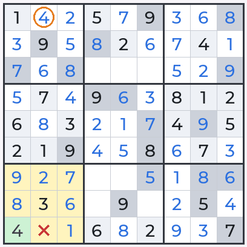

<!-- Written by tools/walkthrough.py fortress: edit the script, not this page. -->
# Fortress, step 47: the 4 in box 7

**Step 47 of 55** · [← Step 46](step-46.md) · [All steps](../fortress.md#the-whole-puzzle-step-by-step) · [Step 48 →](step-48.md)

Box 7 needs a 4. r9c2: column 2 has one (r1c2). Only **r9c1** is left: **r9c1 = 4**.

**Step 47 of 55** · [← Step 46](step-46.md) · [All steps](../fortress.md#the-whole-puzzle-step-by-step) · [Step 48 →](step-48.md)
