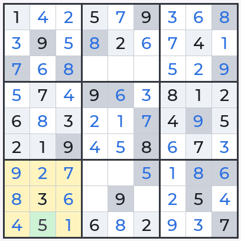

<!-- Written by tools/walkthrough.py fortress: edit the script, not this page. -->
# Fortress, step 48: the 5 in box 7

**Step 48 of 55** · [← Step 47](step-47.md) · [All steps](../fortress.md#the-whole-puzzle-step-by-step) · [Step 49 →](step-49.md)

Box 7 needs a 5, and r9c2 is its last empty cell: **r9c2 = 5**.

**Step 48 of 55** · [← Step 47](step-47.md) · [All steps](../fortress.md#the-whole-puzzle-step-by-step) · [Step 49 →](step-49.md)
