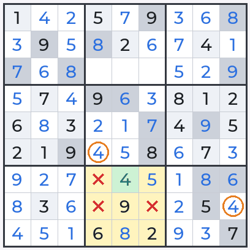

<!-- Written by tools/walkthrough.py fortress: edit the script, not this page. -->
# Fortress, step 49: the 4 in box 8

**Step 49 of 55** · [← Step 48](step-48.md) · [All steps](../fortress.md#the-whole-puzzle-step-by-step) · [Step 50 →](step-50.md)

Box 8 needs a 4. r7c4: column 4 has one (r6c4). r8c4 and r8c6: row 8 has one (r8c9). Only **r7c5** is left: **r7c5 = 4**.

**Step 49 of 55** · [← Step 48](step-48.md) · [All steps](../fortress.md#the-whole-puzzle-step-by-step) · [Step 50 →](step-50.md)
