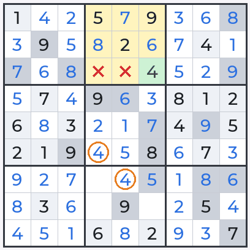

<!-- Written by tools/walkthrough.py fortress: edit the script, not this page. -->
# Fortress, step 50: the 4 in box 2

**Step 50 of 55** · [← Step 49](step-49.md) · [All steps](../fortress.md#the-whole-puzzle-step-by-step) · [Step 51 →](step-51.md)

Box 2 needs a 4. r3c4: column 4 has one (r6c4). r3c5: column 5 has one (r7c5). Only **r3c6** is left: **r3c6 = 4**.

**Step 50 of 55** · [← Step 49](step-49.md) · [All steps](../fortress.md#the-whole-puzzle-step-by-step) · [Step 51 →](step-51.md)
