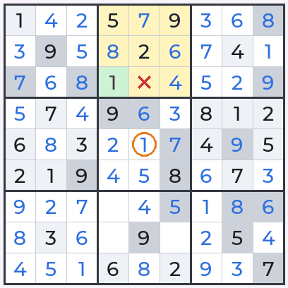

<!-- Written by tools/walkthrough.py fortress: edit the script, not this page. -->
# Fortress, step 51: the 1 in box 2

**Step 51 of 55** · [← Step 50](step-50.md) · [All steps](../fortress.md#the-whole-puzzle-step-by-step) · [Step 52 →](step-52.md)

Box 2 needs a 1. r3c5: column 5 has one (r5c5). Only **r3c4** is left: **r3c4 = 1**.

**Step 51 of 55** · [← Step 50](step-50.md) · [All steps](../fortress.md#the-whole-puzzle-step-by-step) · [Step 52 →](step-52.md)
