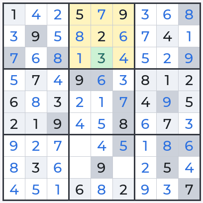

<!-- Written by tools/walkthrough.py fortress: edit the script, not this page. -->
# Fortress, step 52: the 3 in box 2

**Step 52 of 55** · [← Step 51](step-51.md) · [All steps](../fortress.md#the-whole-puzzle-step-by-step) · [Step 53 →](step-53.md)

Box 2 needs a 3, and r3c5 is its last empty cell: **r3c5 = 3**.

**Step 52 of 55** · [← Step 51](step-51.md) · [All steps](../fortress.md#the-whole-puzzle-step-by-step) · [Step 53 →](step-53.md)
