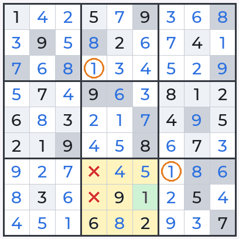

<!-- Written by tools/walkthrough.py fortress: edit the script, not this page. -->
# Fortress, step 53: the 1 in box 8

**Step 53 of 55** · [← Step 52](step-52.md) · [All steps](../fortress.md#the-whole-puzzle-step-by-step) · [Step 54 →](step-54.md)

Box 8 needs a 1. r7c4: row 7 has one (r7c7). r8c4: column 4 has one (r3c4). Only **r8c6** is left: **r8c6 = 1**.

**Step 53 of 55** · [← Step 52](step-52.md) · [All steps](../fortress.md#the-whole-puzzle-step-by-step) · [Step 54 →](step-54.md)
