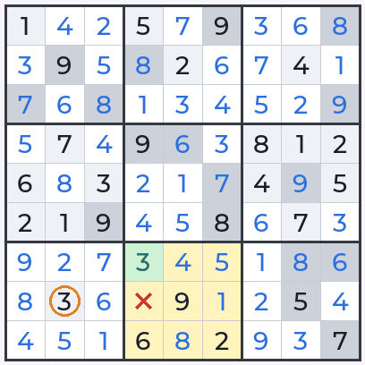

<!-- Written by tools/walkthrough.py fortress: edit the script, not this page. -->
# Fortress, step 54: the 3 in box 8

**Step 54 of 55** · [← Step 53](step-53.md) · [All steps](../fortress.md#the-whole-puzzle-step-by-step) · [Step 55 →](step-55.md)

Box 8 needs a 3. r8c4: row 8 has one (r8c2). Only **r7c4** is left: **r7c4 = 3**.

**Step 54 of 55** · [← Step 53](step-53.md) · [All steps](../fortress.md#the-whole-puzzle-step-by-step) · [Step 55 →](step-55.md)
