# Frame

[← All variants](README.md) · [Puzzles](../features-puzzles.md) · [How to play](../how-to-play.md)

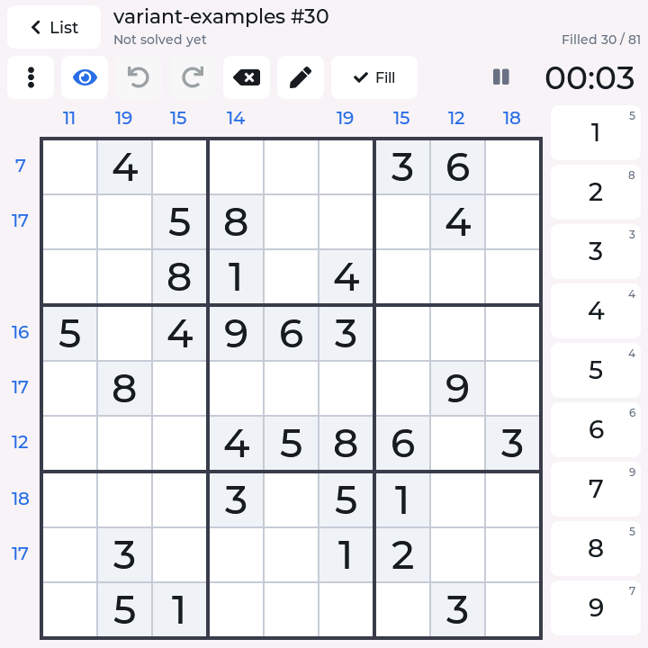

## The rules

[Classic](classic.md) rules, and **clues** left of some rows and above some columns. A clue is **the sum of the first three digits** from there: the three cells of that row or column in the first box. In 6, 2, 5, 1, 9, 8 the clue is 6 + 2 + 5 = 13. A line without a clue has no such rule.

The three cells are in one box, so they never repeat: a clue is 6 (1 + 2 + 3) to 24 (7 + 8 + 9).

## On the board

- The clues are in blue in a margin left of the rows and above the columns; a line without a clue has none.
- The first three cells of a line turn red when they already add up to more than its clue, or (all filled) to something else.
- The grader and hints keep, for each of the three cells, the digits that make the clue with two others the cell's neighbours can still hold: "The first three digits of row 1 add up to its clue 7, so row 1, column 3 can only be 2".
- **Puzzles → ⋮ → New puzzle → Clues → Frame**: about three quarters of the lines have a clue (Hard and Expert: about 60 %).

## How to solve it

- **Extreme clues have one set:** 6 is 1, 2, 3; 7 is 1, 2, 4; 23 is 6, 8, 9; 24 is 7, 8, 9.
- **A clue is a cage without the outline:** treat the three cells like a Killer cage with that sum.
- **Two clues meet in a corner box:** the top-left box has the clue of rows 1–3 and of columns 1–3. Together the row clues of a box add up to 45, and so do its column clues, so one missing clue can be worked out from the other two.
- **A known digit and a clue leave a pair:** with a 4 in the three and a clue of 7, the other two are 1 and 2.

## Worked example

**variant-examples #30**, Frame Easy (see [Classic](classic.md#worked-example-the-whole-puzzle) for how to import the examples; cells are written r*row*c*column*). The clues are in the screenshot; from the left, row 1's is **7**; from the top, column 3's is **15** and column 7's **15**.

**Step 1: r2c7, column 7 (clue 15).** Row 2 has 4, 5 and 8; column 7 has 1, 2, 3 and 6; that leaves 7 and 9. Column 7 starts with r1c7, a 3, so r2c7 and r3c7 add up to 12. With a 9 in r2c7, r3c7 would be another 3. **r2c7 = 7**.

**Step 2: r3c7, the same column.** Now r3c7 is 15 − 3 − 7: **r3c7 = 5** (by the Classic rules it could be 5 or 9).

**Step 3: r1c3, row 1 (clue 7).** Row 1's first three cells are r1c1, a 4 (r1c2) and r1c3: the two empty ones add up to 7 − 4 = 3, so they are 1 and 2. Column 3 has a 1. **r1c3 = 2**. Column 3's clue agrees: 2 + 5 + 8 = 15.

## The whole puzzle, step by step

<!-- walkthrough -->
<!-- Written by tools/walkthrough.py frame: edit the script, not this part. -->

The whole puzzle, from the start to the last cell: 51 steps, each one a single (one place left for a digit, or one digit left for a cell), taken in the order a box's single comes first, so not quite the order of the worked example above. In each picture, the unit the step looks at is tinted yellow (for a cell with one digit left: its row, column and box), the new digit is on green, the digits that rule cells out have an **orange ring**, and the empty cells they rule out a **red cross**. Givens are on grey, digits from earlier steps in blue.

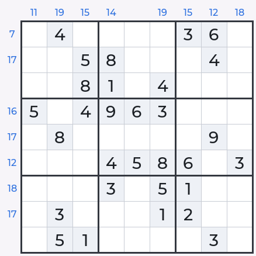

#### Step 1: the 1 in box 1

Box 1 needs a 1. r1c3: column 3 has one (r9c3). r3c1 and r3c2: row 3 has one (r3c4). r2c1: the first three digits of row 2 add up to its clue 17: with a 1 there, its other empty cell would need 11, more than 9. r2c2: it's among the first three digits after a clue of 19, and three different digits adding up to 19 can hold anything but 1. Only **r1c1** is left: **r1c1 = 1**.

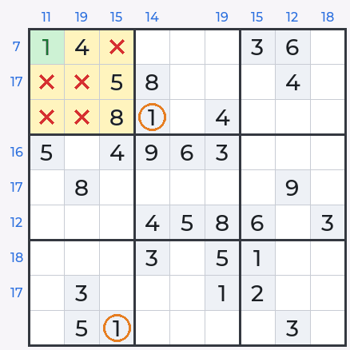

#### Step 2: the 7 in box 1

Box 1 needs a 7. r1c3: it's among the first three digits after a clue of 7, and three different digits adding up to 7 can hold only 1, 2 and 4. r2c1 and r2c2: the first three digits of row 2 add up to its clue 17: with a 7 there, its other empty cell would need 5, and a 5 is among them already. r3c2: the first three digits of column 2 add up to its clue 19: with a 7 there, its other empty cell would need 8, and an 8 is among them already. Only **r3c1** is left: **r3c1 = 7**.

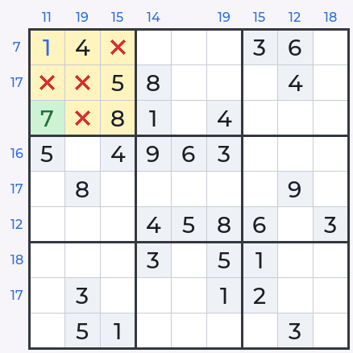

#### Step 3: the 2 in box 1

Box 1 needs a 2. r2c1 and r2c2: the first three digits of row 2 add up to its clue 17: with a 2 there, its other empty cell would need 10, more than 9. r3c2: the first three digits of column 2 add up to its clue 19: with a 2 there, its other empty cell would need 13, more than 9. Only **r1c3** is left: **r1c3 = 2**.

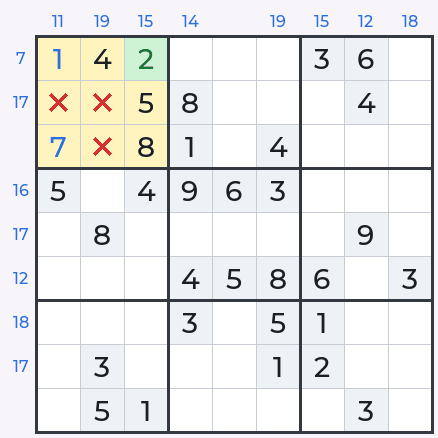

#### Step 4: the 3 in box 1

Box 1 needs a 3. r2c2 and r3c2: column 2 has one (r8c2). Only **r2c1** is left: **r2c1 = 3**.

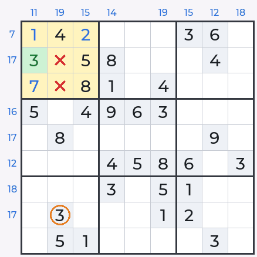

#### Step 5: the 6 in box 1

Box 1 needs a 6. r2c2: the first three digits of row 2 add up to its clue 17, and with a 6 there they'd make 14. Only **r3c2** is left: **r3c2 = 6**.

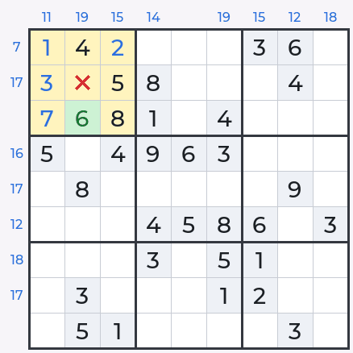

#### Step 6: the 9 in box 1

Box 1 needs a 9, and r2c2 is its last empty cell: **r2c2 = 9**.

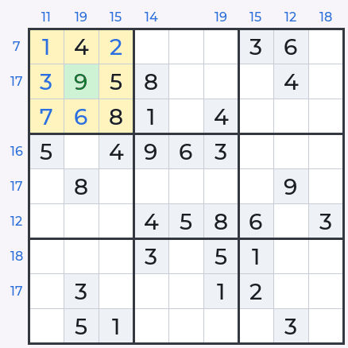

#### Step 7: the 3 in box 2

Box 2 needs a 3. r1c4, r1c5 and r1c6: row 1 has one (r1c7). r2c5 and r2c6: row 2 has one (r2c1). Only **r3c5** is left: **r3c5 = 3**.

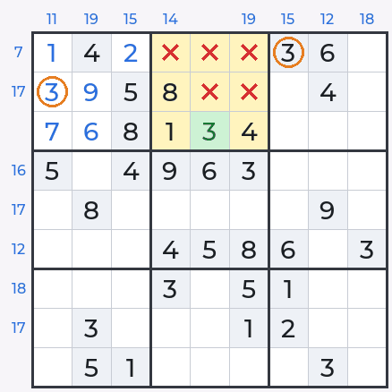

#### Step 8: the 2 in box 2

Box 2 needs a 2. r1c4, r1c5 and r1c6: row 1 has one (r1c3). r2c6: the first three digits of column 6 add up to its clue 19: with a 2 there, its other empty cell would need 13, more than 9. Only **r2c5** is left: **r2c5 = 2**.

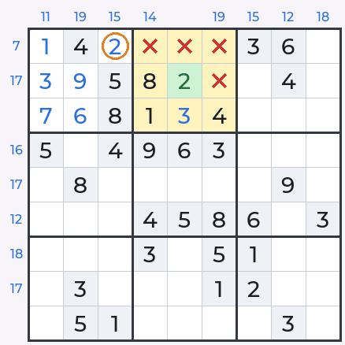

#### Step 9: the 5 in box 2

Box 2 needs a 5. r1c5: column 5 has one (r6c5). r1c6: column 6 has one (r7c6). r2c6: row 2 has one (r2c3). Only **r1c4** is left: **r1c4 = 5**.

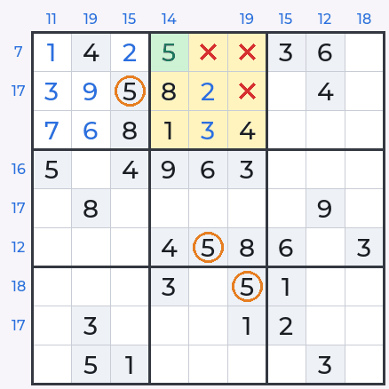

#### Step 10: the 6 in box 2

Box 2 needs a 6. r1c5 and r1c6: row 1 has one (r1c8). Only **r2c6** is left: **r2c6 = 6**.

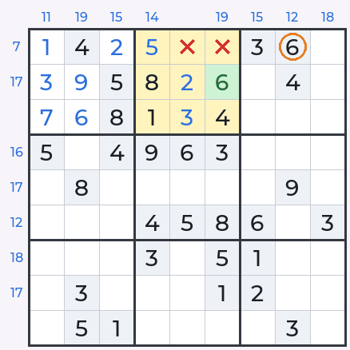

#### Step 11: the 7 in box 2

Box 2 needs a 7. r1c6: the first three digits of column 6 add up to its clue 19, and with a 7 there they'd make 17. Only **r1c5** is left: **r1c5 = 7**.

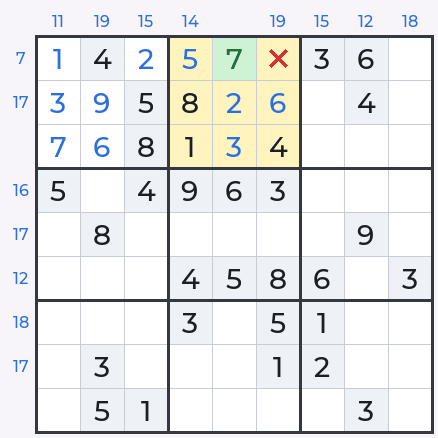

#### Step 12: the 9 in box 2

Box 2 needs a 9, and r1c6 is its last empty cell: **r1c6 = 9**.

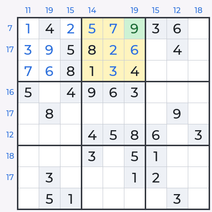

#### Step 13: the 1 in box 3

Box 3 needs a 1. r1c9: row 1 has one (r1c1). r2c7: column 7 has one (r7c7). r3c7, r3c8 and r3c9: row 3 has one (r3c4). Only **r2c9** is left: **r2c9 = 1**.

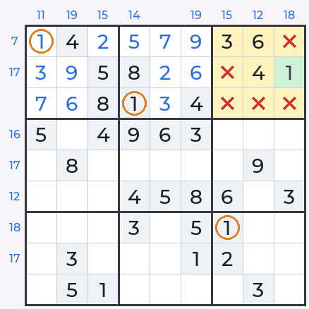

#### Step 14: the 2 in box 3

Box 3 needs a 2. r1c9: row 1 has one (r1c3). r2c7: row 2 has one (r2c5). r3c7: column 7 has one (r8c7). r3c9: the first three digits of column 9 add up to its clue 18: with a 2 there, its other empty cell would need 15, more than 9. Only **r3c8** is left: **r3c8 = 2**.

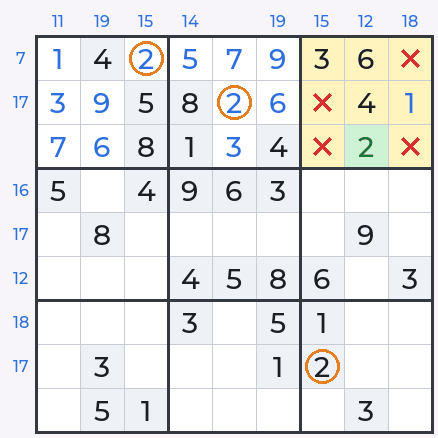

#### Step 15: the 5 in box 3

Box 3 needs a 5. r1c9: row 1 has one (r1c4). r2c7: row 2 has one (r2c3). r3c9: the first three digits of column 9 add up to its clue 18: with a 5 there, its other empty cell would need 12, more than 9. Only **r3c7** is left: **r3c7 = 5**.

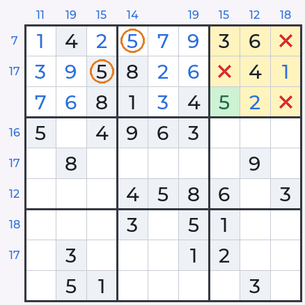

#### Step 16: the 7 in box 3

Box 3 needs a 7. r1c9: row 1 has one (r1c5). r3c9: row 3 has one (r3c1). Only **r2c7** is left: **r2c7 = 7**.

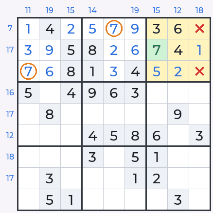

#### Step 17: the 8 in box 3

Box 3 needs an 8. r3c9: row 3 has one (r3c3). Only **r1c9** is left: **r1c9 = 8**.

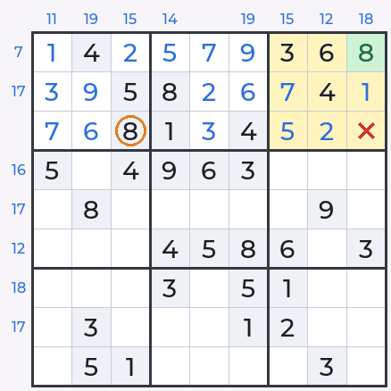

#### Step 18: the 9 in box 3

Box 3 needs a 9, and r3c9 is its last empty cell: **r3c9 = 9**.

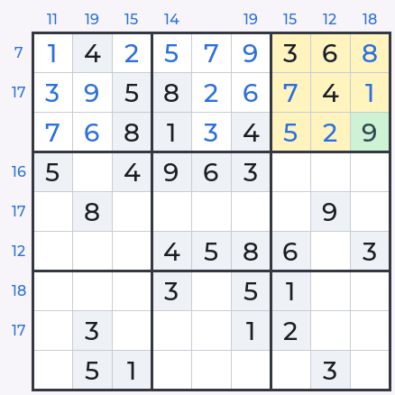

#### Step 19: the 1 in box 4

Box 4 needs a 1. r5c1 and r6c1: column 1 has one (r1c1). r5c3 and r6c3: column 3 has one (r9c3). r4c2: the first three digits of row 4 add up to its clue 16, and with a 1 there they'd make 10. Only **r6c2** is left: **r6c2 = 1**.

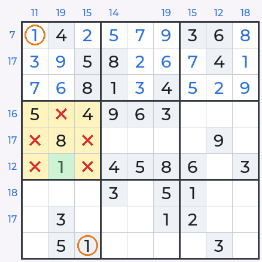

#### Step 20: the 3 in box 4

Box 4 needs a 3. r4c2: row 4 has one (r4c6). r5c1: column 1 has one (r2c1). r6c1 and r6c3: row 6 has one (r6c9). Only **r5c3** is left: **r5c3 = 3**.

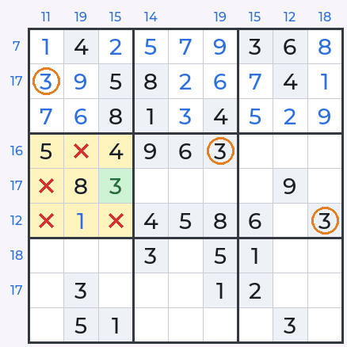

#### Step 21: the 2 in box 4

Box 4 needs a 2. r6c3: column 3 has one (r1c3). r4c2: the first three digits of row 4 add up to its clue 16, and with a 2 there they'd make 11. r5c1: the first three digits of row 5 add up to its clue 17, and with a 2 there they'd make 13. Only **r6c1** is left: **r6c1 = 2**.

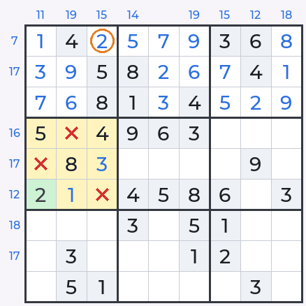

#### Step 22: the 6 in box 4

Box 4 needs a 6. r4c2: row 4 has one (r4c5). r6c3: row 6 has one (r6c7). Only **r5c1** is left: **r5c1 = 6**.

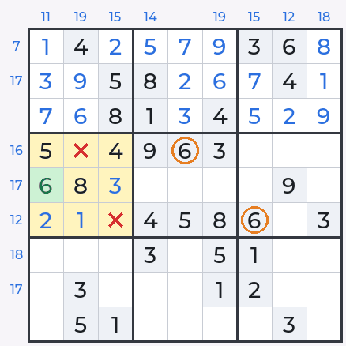

#### Step 23: the 7 in box 4

Box 4 needs a 7. r6c3: the first three digits of row 6 add up to its clue 12, and with a 7 there they'd make 10. Only **r4c2** is left: **r4c2 = 7**.

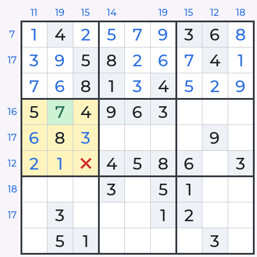

#### Step 24: the 9 in box 4

Box 4 needs a 9, and r6c3 is its last empty cell: **r6c3 = 9**.

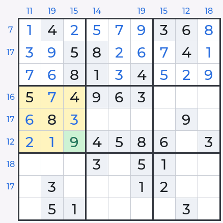

#### Step 25: the 1 in box 5

Box 5 needs a 1. r5c4: column 4 has one (r3c4). r5c6: column 6 has one (r8c6). Only **r5c5** is left: **r5c5 = 1**.

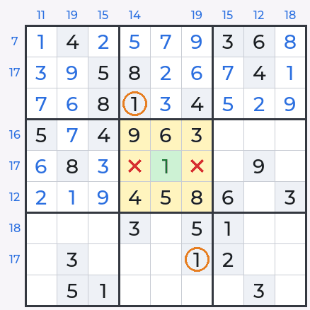

#### Step 26: the 1 in box 6

Box 6 needs a 1. r4c7: column 7 has one (r7c7). r4c9: column 9 has one (r2c9). r5c7 and r5c9: row 5 has one (r5c5). r6c8: row 6 has one (r6c2). Only **r4c8** is left: **r4c8 = 1**.

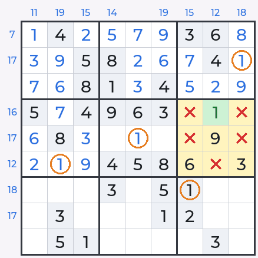

#### Step 27: the 5 in box 6

Box 6 needs a 5. r4c7 and r4c9: row 4 has one (r4c1). r5c7: column 7 has one (r3c7). r6c8: row 6 has one (r6c5). Only **r5c9** is left: **r5c9 = 5**.

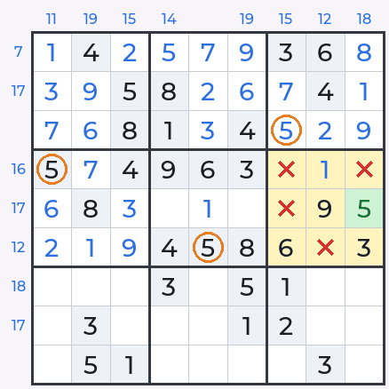

#### Step 28: the 2 in box 6

Box 6 needs a 2. r4c7 and r5c7: column 7 has one (r8c7). r6c8: row 6 has one (r6c1). Only **r4c9** is left: **r4c9 = 2**.

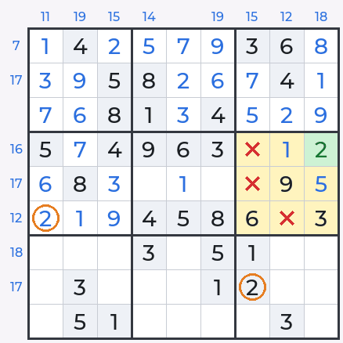

#### Step 29: the 4 in box 6

Box 6 needs a 4. r4c7: row 4 has one (r4c3). r6c8: row 6 has one (r6c4). Only **r5c7** is left: **r5c7 = 4**.

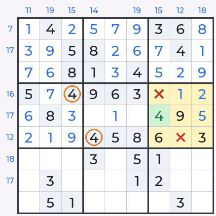

#### Step 30: the 7 in box 6

Box 6 needs a 7. r4c7: row 4 has one (r4c2). Only **r6c8** is left: **r6c8 = 7**.

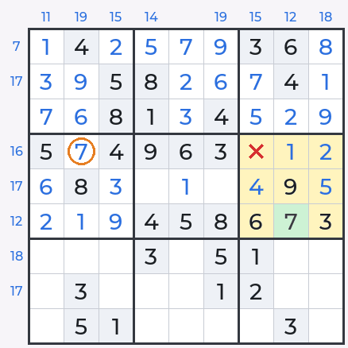

#### Step 31: the 8 in box 6

Box 6 needs an 8, and r4c7 is its last empty cell: **r4c7 = 8**.

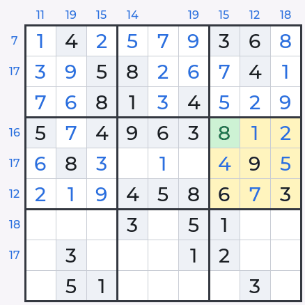

#### Step 32: the 2 in box 7

Box 7 needs a 2. r7c1 and r9c1: column 1 has one (r6c1). r7c3: column 3 has one (r1c3). r8c1 and r8c3: row 8 has one (r8c7). Only **r7c2** is left: **r7c2 = 2**.

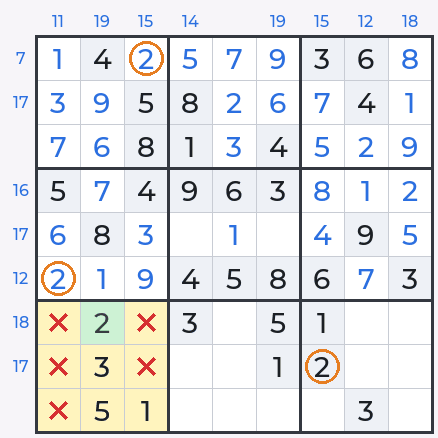

#### Step 33: the 4 in box 7

Box 7 needs a 4. r7c3 and r8c3: column 3 has one (r4c3). r7c1: the first three digits of row 7 add up to its clue 18: with a 4 there, its other empty cell would need 12, more than 9. r8c1: the first three digits of row 8 add up to its clue 17: with a 4 there, its other empty cell would need 10, more than 9. Only **r9c1** is left: **r9c1 = 4**.

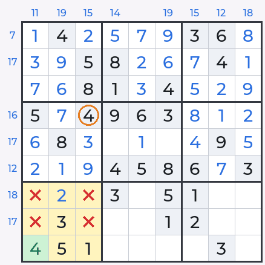

#### Step 34: the 6 in box 7

Box 7 needs a 6. r7c1 and r8c1: column 1 has one (r5c1). r7c3: the first three digits of row 7 add up to its clue 18: with a 6 there, its other empty cell would need 10, more than 9. Only **r8c3** is left: **r8c3 = 6**.

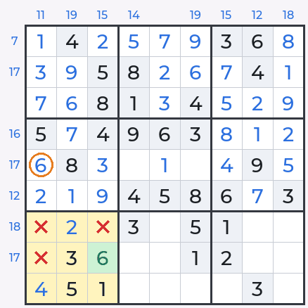

#### Step 35: the 7 in box 7

Box 7 needs a 7. r7c1 and r8c1: column 1 has one (r3c1). Only **r7c3** is left: **r7c3 = 7**.

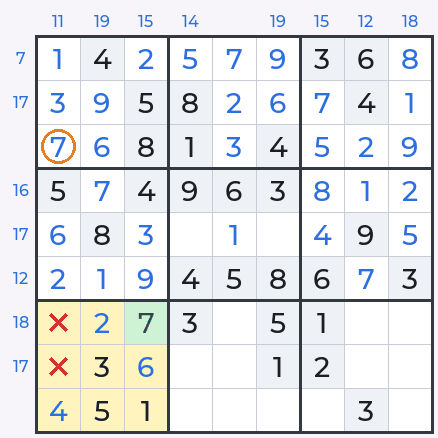

#### Step 36: the 8 in box 7

Box 7 needs an 8. r7c1: the first three digits of row 7 add up to its clue 18, and with an 8 there they'd make 17. Only **r8c1** is left: **r8c1 = 8**.

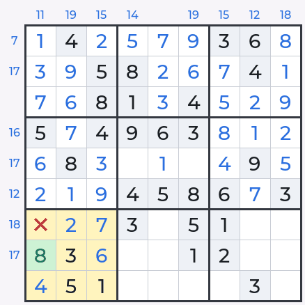

#### Step 37: the 9 in box 7

Box 7 needs a 9, and r7c1 is its last empty cell: **r7c1 = 9**.

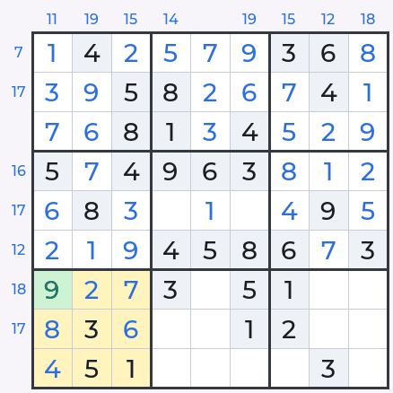

#### Step 38: the 6 in box 8

Box 8 needs a 6. r7c5 and r9c5: column 5 has one (r4c5). r8c4 and r8c5: row 8 has one (r8c3). r9c6: column 6 has one (r2c6). Only **r9c4** is left: **r9c4 = 6**.

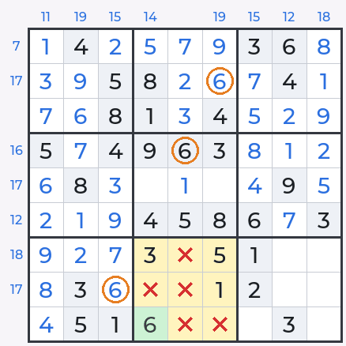

#### Step 39: the 2 in box 8

Box 8 needs a 2. r7c5: row 7 has one (r7c2). r8c4 and r8c5: row 8 has one (r8c7). r9c5: column 5 has one (r2c5). Only **r9c6** is left: **r9c6 = 2**.

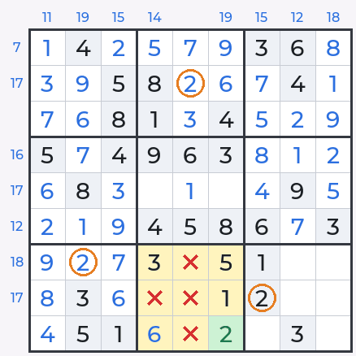

#### Step 40: the 2 in box 5

Box 5 needs a 2. r5c6: column 6 has one (r9c6). Only **r5c4** is left: **r5c4 = 2**.

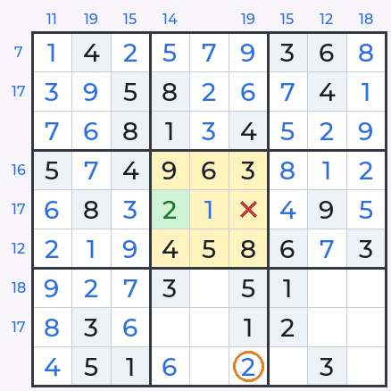

#### Step 41: the 7 in box 5

Box 5 needs a 7, and r5c6 is its last empty cell: **r5c6 = 7**.

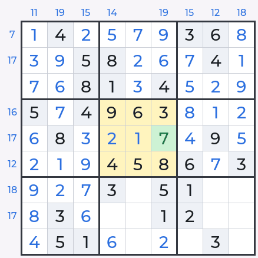

#### Step 42: the 7 in box 8

Box 8 needs a 7. r7c5: row 7 has one (r7c3). r8c5 and r9c5: column 5 has one (r1c5). Only **r8c4** is left: **r8c4 = 7**.

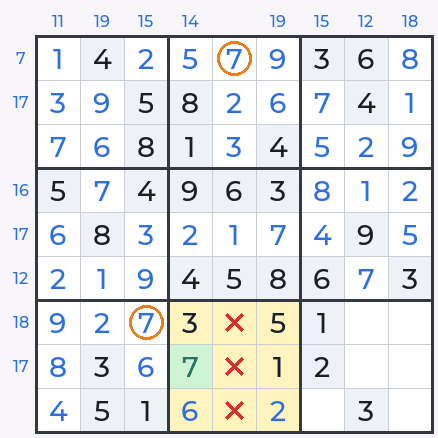

#### Step 43: the 5 in box 9

Box 9 needs a 5. r7c8 and r7c9: row 7 has one (r7c6). r8c9: column 9 has one (r5c9). r9c7 and r9c9: row 9 has one (r9c2). Only **r8c8** is left: **r8c8 = 5**.

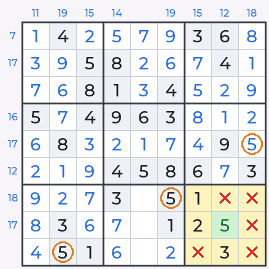

#### Step 44: the 6 in box 9

Box 9 needs a 6. r7c8: column 8 has one (r1c8). r8c9: row 8 has one (r8c3). r9c7 and r9c9: row 9 has one (r9c4). Only **r7c9** is left: **r7c9 = 6**.

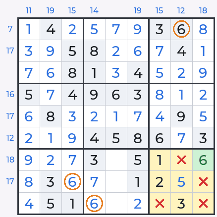

#### Step 45: the 4 in box 9

Box 9 needs a 4. r7c8: column 8 has one (r2c8). r9c7 and r9c9: row 9 has one (r9c1). Only **r8c9** is left: **r8c9 = 4**.

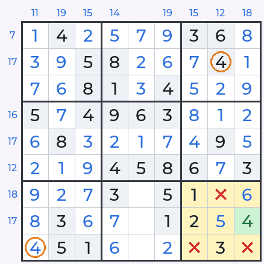

#### Step 46: the 4 in box 8

Box 8 needs a 4. r8c5: row 8 has one (r8c9). r9c5: row 9 has one (r9c1). Only **r7c5** is left: **r7c5 = 4**.

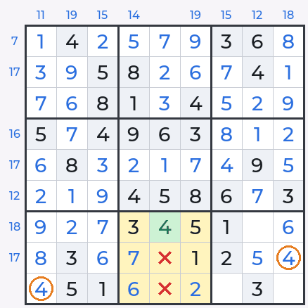

#### Step 47: the 8 in box 8

Box 8 needs an 8. r8c5: row 8 has one (r8c1). Only **r9c5** is left: **r9c5 = 8**.

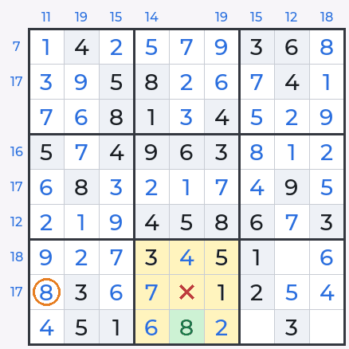

#### Step 48: the 9 in box 8

Box 8 needs a 9, and r8c5 is its last empty cell: **r8c5 = 9**.

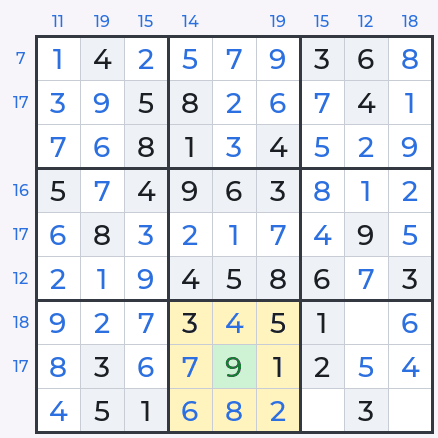

#### Step 49: the 7 in box 9

Box 9 needs a 7. r7c8: row 7 has one (r7c3). r9c7: column 7 has one (r2c7). Only **r9c9** is left: **r9c9 = 7**.

#### Step 50: the 8 in box 9

Box 9 needs an 8. r9c7: row 9 has one (r9c5). Only **r7c8** is left: **r7c8 = 8**.

#### Step 51: the 9 in box 9

Box 9 needs a 9, and r9c7 is its last empty cell: **r9c7 = 9**.

Solved.

<!-- /walkthrough -->
