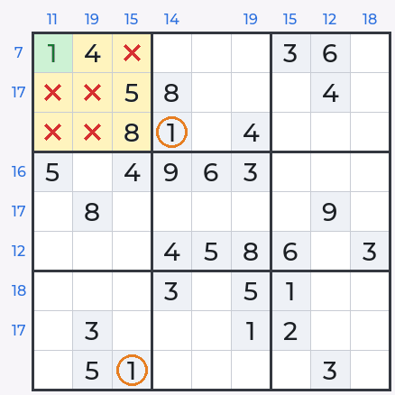

<!-- Written by tools/walkthrough.py frame: edit the script, not this page. -->
# Frame, step 1: the 1 in box 1

**Step 1 of 51** · [← The start](../frame.md#the-whole-puzzle-step-by-step) · [All steps](../frame.md#the-whole-puzzle-step-by-step) · [Step 2 →](step-02.md)

Box 1 needs a 1. r1c3: column 3 has one (r9c3). r3c1 and r3c2: row 3 has one (r3c4). r2c1: the first three digits of row 2 add up to its clue 17: with a 1 there, its other empty cell would need 11, more than 9. r2c2: it's among the first three digits after a clue of 19, and three different digits adding up to 19 can hold anything but 1. Only **r1c1** is left: **r1c1 = 1**.

**Step 1 of 51** · [← The start](../frame.md#the-whole-puzzle-step-by-step) · [All steps](../frame.md#the-whole-puzzle-step-by-step) · [Step 2 →](step-02.md)
