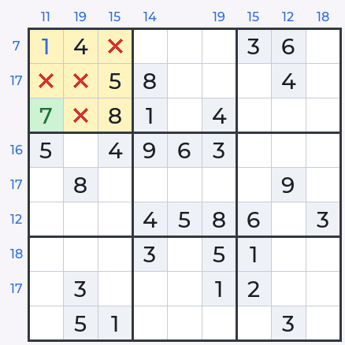

<!-- Written by tools/walkthrough.py frame: edit the script, not this page. -->
# Frame, step 2: the 7 in box 1

**Step 2 of 51** · [← Step 1](step-01.md) · [All steps](../frame.md#the-whole-puzzle-step-by-step) · [Step 3 →](step-03.md)

Box 1 needs a 7. r1c3: it's among the first three digits after a clue of 7, and three different digits adding up to 7 can hold only 1, 2 and 4. r2c1 and r2c2: the first three digits of row 2 add up to its clue 17: with a 7 there, its other empty cell would need 5, and a 5 is among them already. r3c2: the first three digits of column 2 add up to its clue 19: with a 7 there, its other empty cell would need 8, and an 8 is among them already. Only **r3c1** is left: **r3c1 = 7**.

**Step 2 of 51** · [← Step 1](step-01.md) · [All steps](../frame.md#the-whole-puzzle-step-by-step) · [Step 3 →](step-03.md)
