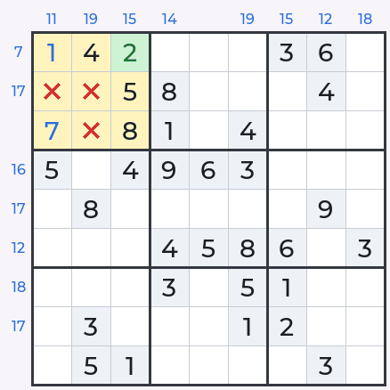

<!-- Written by tools/walkthrough.py frame: edit the script, not this page. -->
# Frame, step 3: the 2 in box 1

**Step 3 of 51** · [← Step 2](step-02.md) · [All steps](../frame.md#the-whole-puzzle-step-by-step) · [Step 4 →](step-04.md)

Box 1 needs a 2. r2c1 and r2c2: the first three digits of row 2 add up to its clue 17: with a 2 there, its other empty cell would need 10, more than 9. r3c2: the first three digits of column 2 add up to its clue 19: with a 2 there, its other empty cell would need 13, more than 9. Only **r1c3** is left: **r1c3 = 2**.

**Step 3 of 51** · [← Step 2](step-02.md) · [All steps](../frame.md#the-whole-puzzle-step-by-step) · [Step 4 →](step-04.md)
