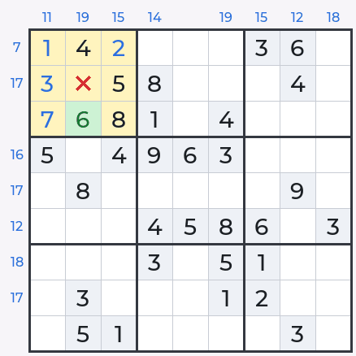

<!-- Written by tools/walkthrough.py frame: edit the script, not this page. -->
# Frame, step 5: the 6 in box 1

**Step 5 of 51** · [← Step 4](step-04.md) · [All steps](../frame.md#the-whole-puzzle-step-by-step) · [Step 6 →](step-06.md)

Box 1 needs a 6. r2c2: the first three digits of row 2 add up to its clue 17, and with a 6 there they'd make 14. Only **r3c2** is left: **r3c2 = 6**.

**Step 5 of 51** · [← Step 4](step-04.md) · [All steps](../frame.md#the-whole-puzzle-step-by-step) · [Step 6 →](step-06.md)
