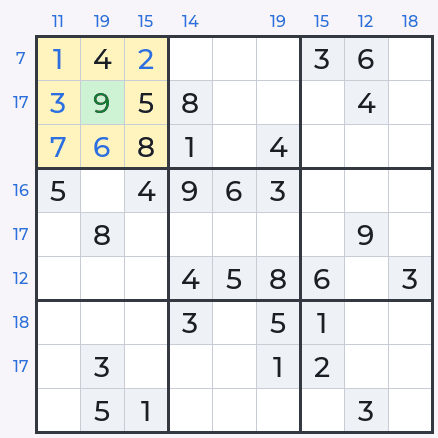

<!-- Written by tools/walkthrough.py frame: edit the script, not this page. -->
# Frame, step 6: the 9 in box 1

**Step 6 of 51** · [← Step 5](step-05.md) · [All steps](../frame.md#the-whole-puzzle-step-by-step) · [Step 7 →](step-07.md)

Box 1 needs a 9, and r2c2 is its last empty cell: **r2c2 = 9**.

**Step 6 of 51** · [← Step 5](step-05.md) · [All steps](../frame.md#the-whole-puzzle-step-by-step) · [Step 7 →](step-07.md)
