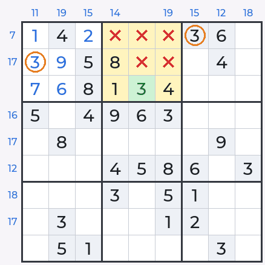

<!-- Written by tools/walkthrough.py frame: edit the script, not this page. -->
# Frame, step 7: the 3 in box 2

**Step 7 of 51** · [← Step 6](step-06.md) · [All steps](../frame.md#the-whole-puzzle-step-by-step) · [Step 8 →](step-08.md)

Box 2 needs a 3. r1c4, r1c5 and r1c6: row 1 has one (r1c7). r2c5 and r2c6: row 2 has one (r2c1). Only **r3c5** is left: **r3c5 = 3**.

**Step 7 of 51** · [← Step 6](step-06.md) · [All steps](../frame.md#the-whole-puzzle-step-by-step) · [Step 8 →](step-08.md)
