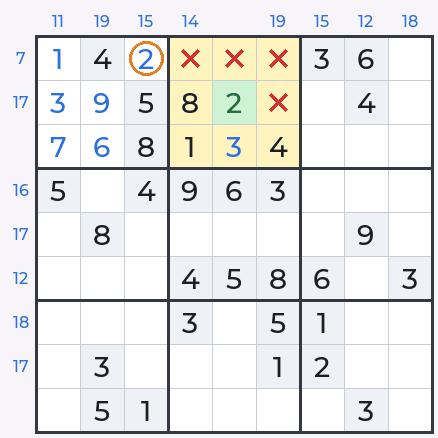

<!-- Written by tools/walkthrough.py frame: edit the script, not this page. -->
# Frame, step 8: the 2 in box 2

**Step 8 of 51** · [← Step 7](step-07.md) · [All steps](../frame.md#the-whole-puzzle-step-by-step) · [Step 9 →](step-09.md)

Box 2 needs a 2. r1c4, r1c5 and r1c6: row 1 has one (r1c3). r2c6: the first three digits of column 6 add up to its clue 19: with a 2 there, its other empty cell would need 13, more than 9. Only **r2c5** is left: **r2c5 = 2**.

**Step 8 of 51** · [← Step 7](step-07.md) · [All steps](../frame.md#the-whole-puzzle-step-by-step) · [Step 9 →](step-09.md)
