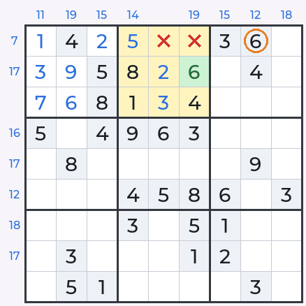

<!-- Written by tools/walkthrough.py frame: edit the script, not this page. -->
# Frame, step 10: the 6 in box 2

**Step 10 of 51** · [← Step 9](step-09.md) · [All steps](../frame.md#the-whole-puzzle-step-by-step) · [Step 11 →](step-11.md)

Box 2 needs a 6. r1c5 and r1c6: row 1 has one (r1c8). Only **r2c6** is left: **r2c6 = 6**.

**Step 10 of 51** · [← Step 9](step-09.md) · [All steps](../frame.md#the-whole-puzzle-step-by-step) · [Step 11 →](step-11.md)
