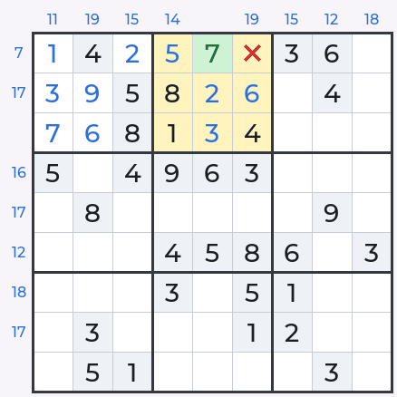

<!-- Written by tools/walkthrough.py frame: edit the script, not this page. -->
# Frame, step 11: the 7 in box 2

**Step 11 of 51** · [← Step 10](step-10.md) · [All steps](../frame.md#the-whole-puzzle-step-by-step) · [Step 12 →](step-12.md)

Box 2 needs a 7. r1c6: the first three digits of column 6 add up to its clue 19, and with a 7 there they'd make 17. Only **r1c5** is left: **r1c5 = 7**.

**Step 11 of 51** · [← Step 10](step-10.md) · [All steps](../frame.md#the-whole-puzzle-step-by-step) · [Step 12 →](step-12.md)
