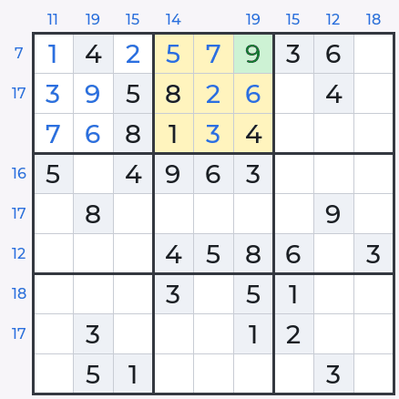

<!-- Written by tools/walkthrough.py frame: edit the script, not this page. -->
# Frame, step 12: the 9 in box 2

**Step 12 of 51** · [← Step 11](step-11.md) · [All steps](../frame.md#the-whole-puzzle-step-by-step) · [Step 13 →](step-13.md)

Box 2 needs a 9, and r1c6 is its last empty cell: **r1c6 = 9**.

**Step 12 of 51** · [← Step 11](step-11.md) · [All steps](../frame.md#the-whole-puzzle-step-by-step) · [Step 13 →](step-13.md)
