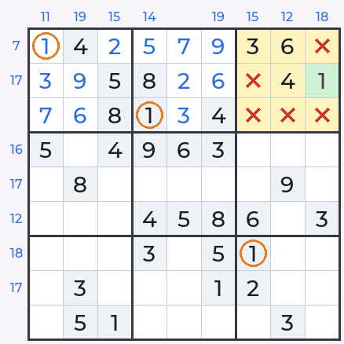

<!-- Written by tools/walkthrough.py frame: edit the script, not this page. -->
# Frame, step 13: the 1 in box 3

**Step 13 of 51** · [← Step 12](step-12.md) · [All steps](../frame.md#the-whole-puzzle-step-by-step) · [Step 14 →](step-14.md)

Box 3 needs a 1. r1c9: row 1 has one (r1c1). r2c7: column 7 has one (r7c7). r3c7, r3c8 and r3c9: row 3 has one (r3c4). Only **r2c9** is left: **r2c9 = 1**.

**Step 13 of 51** · [← Step 12](step-12.md) · [All steps](../frame.md#the-whole-puzzle-step-by-step) · [Step 14 →](step-14.md)
