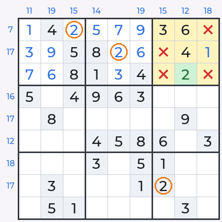

<!-- Written by tools/walkthrough.py frame: edit the script, not this page. -->
# Frame, step 14: the 2 in box 3

**Step 14 of 51** · [← Step 13](step-13.md) · [All steps](../frame.md#the-whole-puzzle-step-by-step) · [Step 15 →](step-15.md)

Box 3 needs a 2. r1c9: row 1 has one (r1c3). r2c7: row 2 has one (r2c5). r3c7: column 7 has one (r8c7). r3c9: the first three digits of column 9 add up to its clue 18: with a 2 there, its other empty cell would need 15, more than 9. Only **r3c8** is left: **r3c8 = 2**.

**Step 14 of 51** · [← Step 13](step-13.md) · [All steps](../frame.md#the-whole-puzzle-step-by-step) · [Step 15 →](step-15.md)
