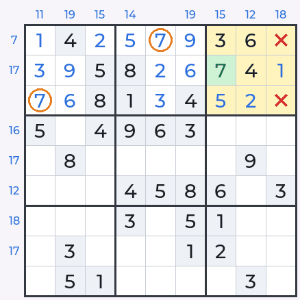

<!-- Written by tools/walkthrough.py frame: edit the script, not this page. -->
# Frame, step 16: the 7 in box 3

**Step 16 of 51** · [← Step 15](step-15.md) · [All steps](../frame.md#the-whole-puzzle-step-by-step) · [Step 17 →](step-17.md)

Box 3 needs a 7. r1c9: row 1 has one (r1c5). r3c9: row 3 has one (r3c1). Only **r2c7** is left: **r2c7 = 7**.

**Step 16 of 51** · [← Step 15](step-15.md) · [All steps](../frame.md#the-whole-puzzle-step-by-step) · [Step 17 →](step-17.md)
