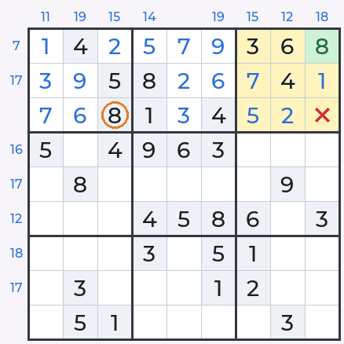

<!-- Written by tools/walkthrough.py frame: edit the script, not this page. -->
# Frame, step 17: the 8 in box 3

**Step 17 of 51** · [← Step 16](step-16.md) · [All steps](../frame.md#the-whole-puzzle-step-by-step) · [Step 18 →](step-18.md)

Box 3 needs an 8. r3c9: row 3 has one (r3c3). Only **r1c9** is left: **r1c9 = 8**.

**Step 17 of 51** · [← Step 16](step-16.md) · [All steps](../frame.md#the-whole-puzzle-step-by-step) · [Step 18 →](step-18.md)
