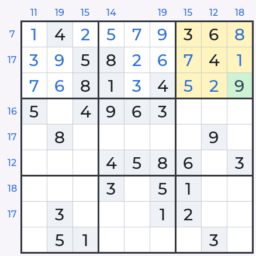

<!-- Written by tools/walkthrough.py frame: edit the script, not this page. -->
# Frame, step 18: the 9 in box 3

**Step 18 of 51** · [← Step 17](step-17.md) · [All steps](../frame.md#the-whole-puzzle-step-by-step) · [Step 19 →](step-19.md)

Box 3 needs a 9, and r3c9 is its last empty cell: **r3c9 = 9**.

**Step 18 of 51** · [← Step 17](step-17.md) · [All steps](../frame.md#the-whole-puzzle-step-by-step) · [Step 19 →](step-19.md)
