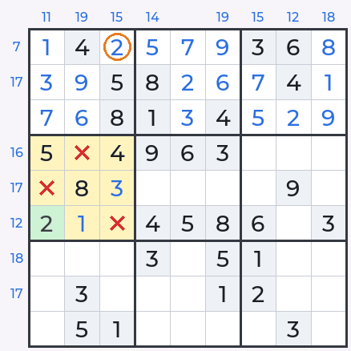

<!-- Written by tools/walkthrough.py frame: edit the script, not this page. -->
# Frame, step 21: the 2 in box 4

**Step 21 of 51** · [← Step 20](step-20.md) · [All steps](../frame.md#the-whole-puzzle-step-by-step) · [Step 22 →](step-22.md)

Box 4 needs a 2. r6c3: column 3 has one (r1c3). r4c2: the first three digits of row 4 add up to its clue 16, and with a 2 there they'd make 11. r5c1: the first three digits of row 5 add up to its clue 17, and with a 2 there they'd make 13. Only **r6c1** is left: **r6c1 = 2**.

**Step 21 of 51** · [← Step 20](step-20.md) · [All steps](../frame.md#the-whole-puzzle-step-by-step) · [Step 22 →](step-22.md)
