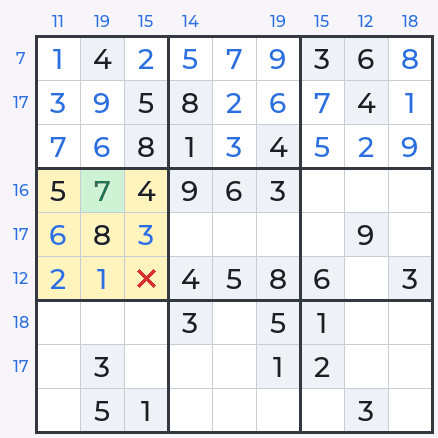

<!-- Written by tools/walkthrough.py frame: edit the script, not this page. -->
# Frame, step 23: the 7 in box 4

**Step 23 of 51** · [← Step 22](step-22.md) · [All steps](../frame.md#the-whole-puzzle-step-by-step) · [Step 24 →](step-24.md)

Box 4 needs a 7. r6c3: the first three digits of row 6 add up to its clue 12, and with a 7 there they'd make 10. Only **r4c2** is left: **r4c2 = 7**.

**Step 23 of 51** · [← Step 22](step-22.md) · [All steps](../frame.md#the-whole-puzzle-step-by-step) · [Step 24 →](step-24.md)
