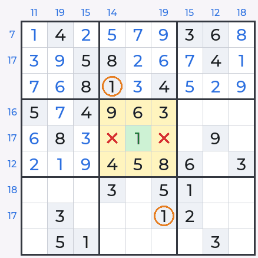

<!-- Written by tools/walkthrough.py frame: edit the script, not this page. -->
# Frame, step 25: the 1 in box 5

**Step 25 of 51** · [← Step 24](step-24.md) · [All steps](../frame.md#the-whole-puzzle-step-by-step) · [Step 26 →](step-26.md)

Box 5 needs a 1. r5c4: column 4 has one (r3c4). r5c6: column 6 has one (r8c6). Only **r5c5** is left: **r5c5 = 1**.

**Step 25 of 51** · [← Step 24](step-24.md) · [All steps](../frame.md#the-whole-puzzle-step-by-step) · [Step 26 →](step-26.md)
