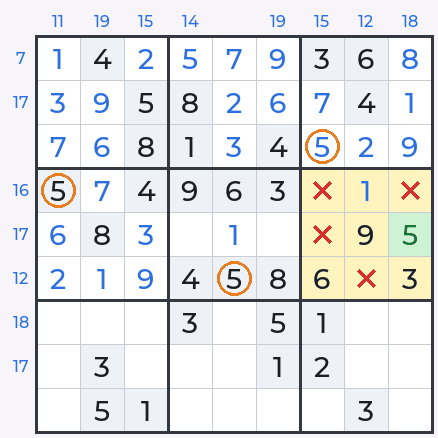

<!-- Written by tools/walkthrough.py frame: edit the script, not this page. -->
# Frame, step 27: the 5 in box 6

**Step 27 of 51** · [← Step 26](step-26.md) · [All steps](../frame.md#the-whole-puzzle-step-by-step) · [Step 28 →](step-28.md)

Box 6 needs a 5. r4c7 and r4c9: row 4 has one (r4c1). r5c7: column 7 has one (r3c7). r6c8: row 6 has one (r6c5). Only **r5c9** is left: **r5c9 = 5**.

**Step 27 of 51** · [← Step 26](step-26.md) · [All steps](../frame.md#the-whole-puzzle-step-by-step) · [Step 28 →](step-28.md)
