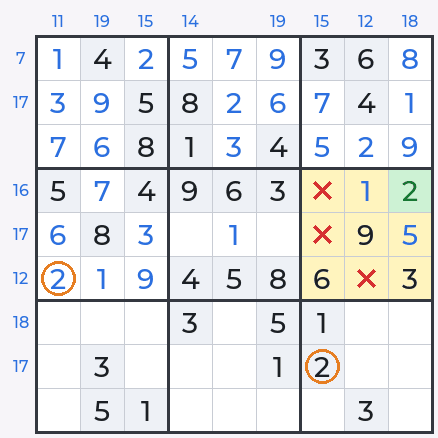

<!-- Written by tools/walkthrough.py frame: edit the script, not this page. -->
# Frame, step 28: the 2 in box 6

**Step 28 of 51** · [← Step 27](step-27.md) · [All steps](../frame.md#the-whole-puzzle-step-by-step) · [Step 29 →](step-29.md)

Box 6 needs a 2. r4c7 and r5c7: column 7 has one (r8c7). r6c8: row 6 has one (r6c1). Only **r4c9** is left: **r4c9 = 2**.

**Step 28 of 51** · [← Step 27](step-27.md) · [All steps](../frame.md#the-whole-puzzle-step-by-step) · [Step 29 →](step-29.md)
