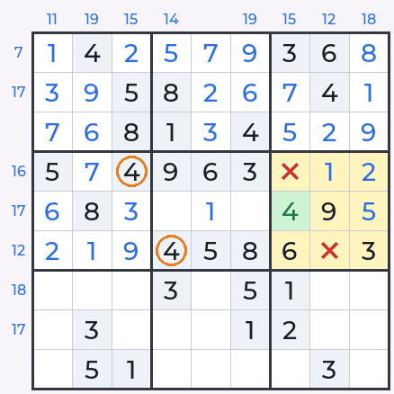

<!-- Written by tools/walkthrough.py frame: edit the script, not this page. -->
# Frame, step 29: the 4 in box 6

**Step 29 of 51** · [← Step 28](step-28.md) · [All steps](../frame.md#the-whole-puzzle-step-by-step) · [Step 30 →](step-30.md)

Box 6 needs a 4. r4c7: row 4 has one (r4c3). r6c8: row 6 has one (r6c4). Only **r5c7** is left: **r5c7 = 4**.

**Step 29 of 51** · [← Step 28](step-28.md) · [All steps](../frame.md#the-whole-puzzle-step-by-step) · [Step 30 →](step-30.md)
