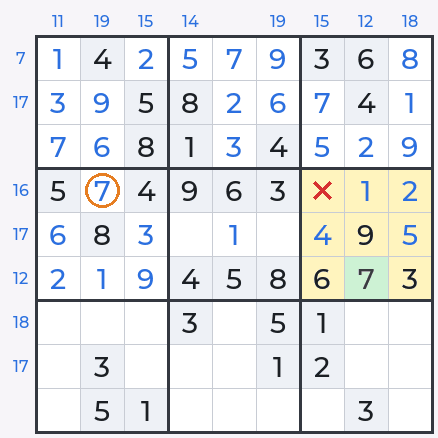

<!-- Written by tools/walkthrough.py frame: edit the script, not this page. -->
# Frame, step 30: the 7 in box 6

**Step 30 of 51** · [← Step 29](step-29.md) · [All steps](../frame.md#the-whole-puzzle-step-by-step) · [Step 31 →](step-31.md)

Box 6 needs a 7. r4c7: row 4 has one (r4c2). Only **r6c8** is left: **r6c8 = 7**.

**Step 30 of 51** · [← Step 29](step-29.md) · [All steps](../frame.md#the-whole-puzzle-step-by-step) · [Step 31 →](step-31.md)
