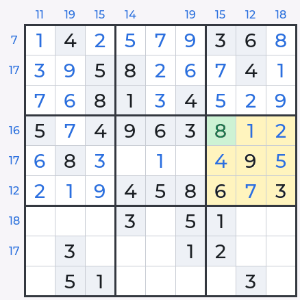

<!-- Written by tools/walkthrough.py frame: edit the script, not this page. -->
# Frame, step 31: the 8 in box 6

**Step 31 of 51** · [← Step 30](step-30.md) · [All steps](../frame.md#the-whole-puzzle-step-by-step) · [Step 32 →](step-32.md)

Box 6 needs an 8, and r4c7 is its last empty cell: **r4c7 = 8**.

**Step 31 of 51** · [← Step 30](step-30.md) · [All steps](../frame.md#the-whole-puzzle-step-by-step) · [Step 32 →](step-32.md)
