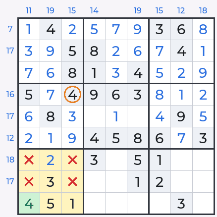

<!-- Written by tools/walkthrough.py frame: edit the script, not this page. -->
# Frame, step 33: the 4 in box 7

**Step 33 of 51** · [← Step 32](step-32.md) · [All steps](../frame.md#the-whole-puzzle-step-by-step) · [Step 34 →](step-34.md)

Box 7 needs a 4. r7c3 and r8c3: column 3 has one (r4c3). r7c1: the first three digits of row 7 add up to its clue 18: with a 4 there, its other empty cell would need 12, more than 9. r8c1: the first three digits of row 8 add up to its clue 17: with a 4 there, its other empty cell would need 10, more than 9. Only **r9c1** is left: **r9c1 = 4**.

**Step 33 of 51** · [← Step 32](step-32.md) · [All steps](../frame.md#the-whole-puzzle-step-by-step) · [Step 34 →](step-34.md)
