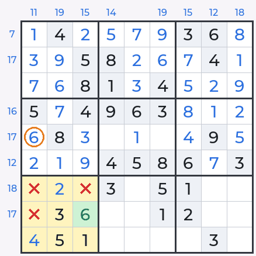

<!-- Written by tools/walkthrough.py frame: edit the script, not this page. -->
# Frame, step 34: the 6 in box 7

**Step 34 of 51** · [← Step 33](step-33.md) · [All steps](../frame.md#the-whole-puzzle-step-by-step) · [Step 35 →](step-35.md)

Box 7 needs a 6. r7c1 and r8c1: column 1 has one (r5c1). r7c3: the first three digits of row 7 add up to its clue 18: with a 6 there, its other empty cell would need 10, more than 9. Only **r8c3** is left: **r8c3 = 6**.

**Step 34 of 51** · [← Step 33](step-33.md) · [All steps](../frame.md#the-whole-puzzle-step-by-step) · [Step 35 →](step-35.md)
