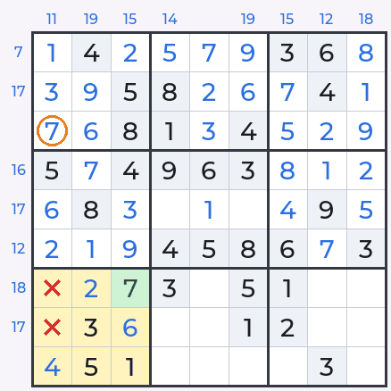

<!-- Written by tools/walkthrough.py frame: edit the script, not this page. -->
# Frame, step 35: the 7 in box 7

**Step 35 of 51** · [← Step 34](step-34.md) · [All steps](../frame.md#the-whole-puzzle-step-by-step) · [Step 36 →](step-36.md)

Box 7 needs a 7. r7c1 and r8c1: column 1 has one (r3c1). Only **r7c3** is left: **r7c3 = 7**.

**Step 35 of 51** · [← Step 34](step-34.md) · [All steps](../frame.md#the-whole-puzzle-step-by-step) · [Step 36 →](step-36.md)
