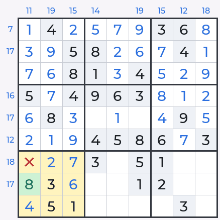

<!-- Written by tools/walkthrough.py frame: edit the script, not this page. -->
# Frame, step 36: the 8 in box 7

**Step 36 of 51** · [← Step 35](step-35.md) · [All steps](../frame.md#the-whole-puzzle-step-by-step) · [Step 37 →](step-37.md)

Box 7 needs an 8. r7c1: the first three digits of row 7 add up to its clue 18, and with an 8 there they'd make 17. Only **r8c1** is left: **r8c1 = 8**.

**Step 36 of 51** · [← Step 35](step-35.md) · [All steps](../frame.md#the-whole-puzzle-step-by-step) · [Step 37 →](step-37.md)
