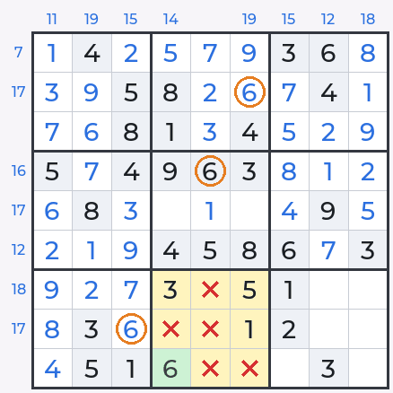

<!-- Written by tools/walkthrough.py frame: edit the script, not this page. -->
# Frame, step 38: the 6 in box 8

**Step 38 of 51** · [← Step 37](step-37.md) · [All steps](../frame.md#the-whole-puzzle-step-by-step) · [Step 39 →](step-39.md)

Box 8 needs a 6. r7c5 and r9c5: column 5 has one (r4c5). r8c4 and r8c5: row 8 has one (r8c3). r9c6: column 6 has one (r2c6). Only **r9c4** is left: **r9c4 = 6**.

**Step 38 of 51** · [← Step 37](step-37.md) · [All steps](../frame.md#the-whole-puzzle-step-by-step) · [Step 39 →](step-39.md)
