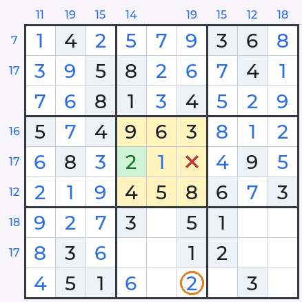

<!-- Written by tools/walkthrough.py frame: edit the script, not this page. -->
# Frame, step 40: the 2 in box 5

**Step 40 of 51** · [← Step 39](step-39.md) · [All steps](../frame.md#the-whole-puzzle-step-by-step) · [Step 41 →](step-41.md)

Box 5 needs a 2. r5c6: column 6 has one (r9c6). Only **r5c4** is left: **r5c4 = 2**.

**Step 40 of 51** · [← Step 39](step-39.md) · [All steps](../frame.md#the-whole-puzzle-step-by-step) · [Step 41 →](step-41.md)
