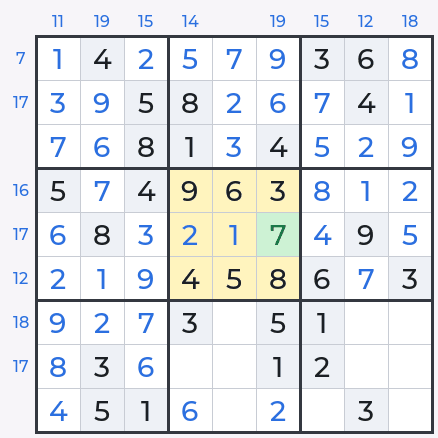

<!-- Written by tools/walkthrough.py frame: edit the script, not this page. -->
# Frame, step 41: the 7 in box 5

**Step 41 of 51** · [← Step 40](step-40.md) · [All steps](../frame.md#the-whole-puzzle-step-by-step) · [Step 42 →](step-42.md)

Box 5 needs a 7, and r5c6 is its last empty cell: **r5c6 = 7**.

**Step 41 of 51** · [← Step 40](step-40.md) · [All steps](../frame.md#the-whole-puzzle-step-by-step) · [Step 42 →](step-42.md)
