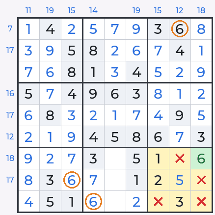

<!-- Written by tools/walkthrough.py frame: edit the script, not this page. -->
# Frame, step 44: the 6 in box 9

**Step 44 of 51** · [← Step 43](step-43.md) · [All steps](../frame.md#the-whole-puzzle-step-by-step) · [Step 45 →](step-45.md)

Box 9 needs a 6. r7c8: column 8 has one (r1c8). r8c9: row 8 has one (r8c3). r9c7 and r9c9: row 9 has one (r9c4). Only **r7c9** is left: **r7c9 = 6**.

**Step 44 of 51** · [← Step 43](step-43.md) · [All steps](../frame.md#the-whole-puzzle-step-by-step) · [Step 45 →](step-45.md)
