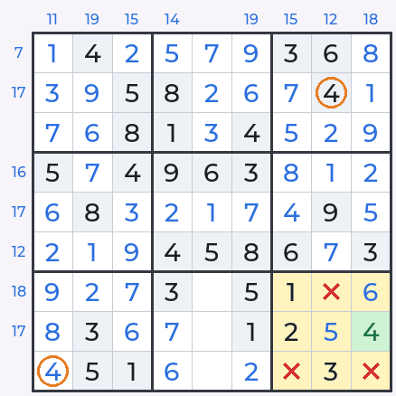

<!-- Written by tools/walkthrough.py frame: edit the script, not this page. -->
# Frame, step 45: the 4 in box 9

**Step 45 of 51** · [← Step 44](step-44.md) · [All steps](../frame.md#the-whole-puzzle-step-by-step) · [Step 46 →](step-46.md)

Box 9 needs a 4. r7c8: column 8 has one (r2c8). r9c7 and r9c9: row 9 has one (r9c1). Only **r8c9** is left: **r8c9 = 4**.

**Step 45 of 51** · [← Step 44](step-44.md) · [All steps](../frame.md#the-whole-puzzle-step-by-step) · [Step 46 →](step-46.md)
