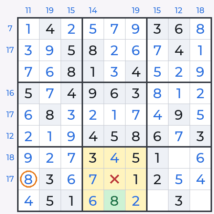

<!-- Written by tools/walkthrough.py frame: edit the script, not this page. -->
# Frame, step 47: the 8 in box 8

**Step 47 of 51** · [← Step 46](step-46.md) · [All steps](../frame.md#the-whole-puzzle-step-by-step) · [Step 48 →](step-48.md)

Box 8 needs an 8. r8c5: row 8 has one (r8c1). Only **r9c5** is left: **r9c5 = 8**.

**Step 47 of 51** · [← Step 46](step-46.md) · [All steps](../frame.md#the-whole-puzzle-step-by-step) · [Step 48 →](step-48.md)
