# German Whispers

[← All variants](README.md) · [Puzzles](../features-puzzles.md) · [How to play](../how-to-play.md)

## The rules

[Classic](classic.md) rules, plus **green lines** through cells side by side or diagonal. Along a line, **two neighbours differ by at least 5**: 2 next to 8 is fine, 3 next to 7 isn't. So a line alternates low and high digits, and there's **never a 5 on a line** (nothing is 5 away from it).

## On the board

- Each line is a narrow green line under the digits.
- Two neighbours on a line less than 5 apart turn red.
- The grader and hints narrow each line cell by its neighbours: "Along this line, neighbours are 5 or more apart, so row 4, column 9 can only be 1, 2, 3, 4".
- **Puzzles → ⋮ → New puzzle → Whispers** (German Whispers): 8 lines (Hard and Expert 10) of 3 to 6 cells.

## How to solve it

- **No 5 on a line.** Ever: rule it out of every green cell first.
- **Low and high alternate:** the digits 1–4 are "low", 6–9 "high"; along a line they take turns. Once one cell's side is known, the whole line's is.
- **4 and 6 are fussy:** the only digit 5 or more away from a 4 is 9, and from a 6 it's 1. A 4 in the middle of a line needs a 9 on each side, so those two cells mustn't share a row, column or box.
- **Next to an extreme, little is left:** next to a 9, a cell is 1 to 4; next to an 8, 1 to 3.

## Worked example

**variant-examples #23**, German Whispers Easy (see [Classic](classic.md#worked-example-the-whole-puzzle) for how to import the examples; cells are written r*row*c*column*). The lines are in the screenshot; three matter here:

- r6c9, r5c8 (a 9), r4c9;
- r6c2 (a 1), r5c2 (an 8), r6c1, r7c1;
- r1c8, r2c9, r1c9 (an 8).

**Step 1: r4c9, next to a 9.** Row 4 has 9, 6, 3, 4 and 1; column 9 has 8 and 5; that leaves 2 and 7. On its line, r4c9 is next to the 9 in r5c8, and 7 is only 2 away from 9. **r4c9 = 2**.

**Step 2: the 9 in row 6.** Row 6 needs a 9; its empty cells are r6c1, r6c3, r6c8 and r6c9.

- r6c8, r6c9: column 8 and box 6 have a 9 (r5c8).
- r6c1: on its line it's next to the 8 in r5c2, so it's at most 3.

Only **r6c3** is left: **r6c3 = 9**.

**Step 3: the 9 in row 2.** Row 2 needs a 9; columns 3, 4, 6, 7 and 8 already have one, which rules out r2c3, r2c4, r2c6, r2c7 and r2c8. And r2c9 is on a line next to the 8 in r1c9, so it's at most 3. Only **r2c2** is left: **r2c2 = 9**.

## The whole puzzle, step by step

<!-- walkthrough -->
<!-- Written by tools/walkthrough.py german-whispers: edit the script, not this part. -->

The whole puzzle, from the start to the last cell: 51 steps, each one a single (one place left for a digit, or one digit left for a cell), taken in the order a box's single comes first, so not quite the order of the worked example above. In each picture, the unit the step looks at is tinted yellow (for a cell with one digit left: its row, column and box), the new digit is on green, the digits that rule cells out have an **orange ring**, and the empty cells they rule out a **red cross**. Givens are on grey, digits from earlier steps in blue.

#### Step 1: the 8 in box 2

Box 2 needs an 8. r1c4 and r1c5: row 1 has one (r1c9). r2c6 and r3c6: column 6 has one (r6c6). r3c4: it's next to the 9 in r4c4 on a green line, and 8 is less than 5 away from it. Only **r2c4** is left: **r2c4 = 8**.

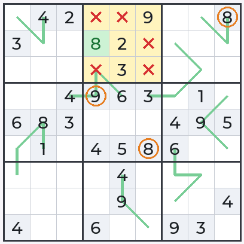

#### Step 2: the 3 in box 3

Box 3 needs a 3. r1c8: column 8 has one (r9c8). r2c7, r2c8 and r2c9: row 2 has one (r2c1). r3c7, r3c8 and r3c9: row 3 has one (r3c5). Only **r1c7** is left: **r1c7 = 3**.

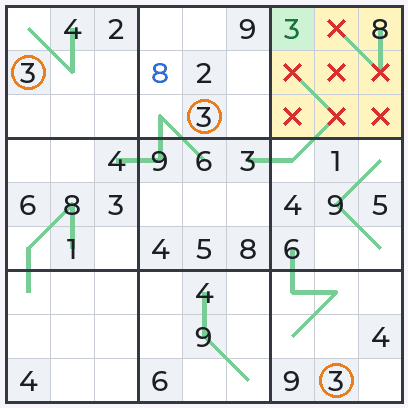

#### Step 3: the 9 in box 3

Box 3 needs a 9. r1c8: row 1 has one (r1c6). r2c7 and r3c7: column 7 has one (r9c7). r2c8 and r3c8: column 8 has one (r5c8). r2c9: it's next to the 8 in r1c9 on a green line, and 9 is less than 5 away from it. Only **r3c9** is left: **r3c9 = 9**.

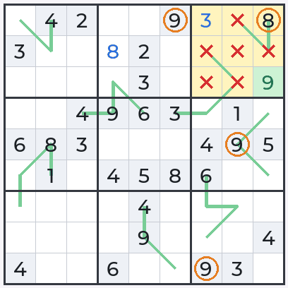

#### Step 4: the 9 in box 4

Box 4 needs a 9. r4c1 and r4c2: row 4 has one (r4c4). r6c1: it's next to the 8 in r5c2 on a green line, and 9 is less than 5 away from it. Only **r6c3** is left: **r6c3 = 9**.

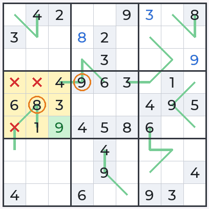

#### Step 5: the 9 in box 1

Box 1 needs a 9. r1c1: row 1 has one (r1c6). r2c3: column 3 has one (r6c3). r3c1, r3c2 and r3c3: row 3 has one (r3c9). Only **r2c2** is left: **r2c2 = 9**.

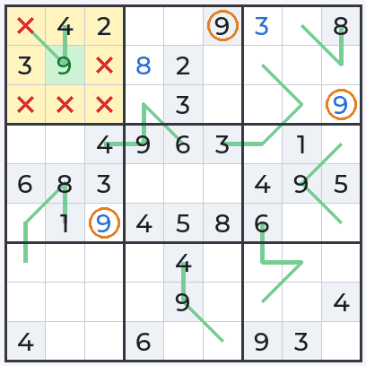

#### Step 6: the 3 in box 6

Box 6 needs a 3. r4c7 and r4c9: row 4 has one (r4c6). r6c8: column 8 has one (r9c8). Only **r6c9** is left: **r6c9 = 3**.

#### Step 7: the 7 in box 6

Box 6 needs a 7. r4c7: it's next to the 3 in r4c6 on a green line, and 7 is less than 5 away from it. r4c9: it's next to the 9 in r5c8 on a green line, and 7 is less than 5 away from it. Only **r6c8** is left: **r6c8 = 7**.

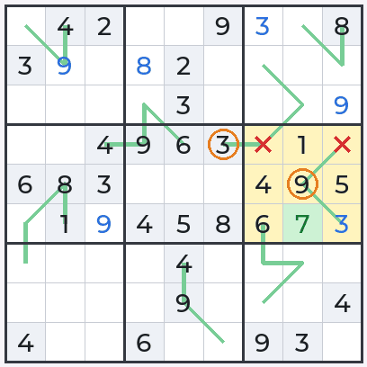

#### Step 8: the 2 in box 6

Box 6 needs a 2. r4c7: it's next to the 3 in r4c6 on a green line, and 2 is less than 5 away from it. Only **r4c9** is left: **r4c9 = 2**.

#### Step 9: the 2 in box 4

Box 4 needs a 2. r4c1 and r4c2: row 4 has one (r4c9). Only **r6c1** is left: **r6c1 = 2**.

#### Step 10: the 8 in box 6

Box 6 needs an 8, and r4c7 is its last empty cell: **r4c7 = 8**.

#### Step 11: the 4 in box 3

Box 3 needs a 4. r1c8: row 1 has one (r1c2). r2c7 and r3c7: column 7 has one (r5c7). r2c9: column 9 has one (r8c9). r3c8: it's next to the 8 in r4c7 on a green line, and 4 is less than 5 away from it. Only **r2c8** is left: **r2c8 = 4**.

#### Step 12: the 4 in box 2

Box 2 needs a 4. r1c4 and r1c5: row 1 has one (r1c2). r2c6: row 2 has one (r2c8). r3c4: column 4 has one (r6c4). Only **r3c6** is left: **r3c6 = 4**.

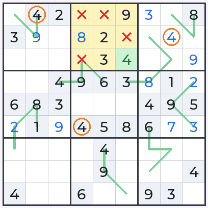

#### Step 13: the 6 in box 2

Box 2 needs a 6. r1c4 and r3c4: column 4 has one (r9c4). r1c5: column 5 has one (r4c5). Only **r2c6** is left: **r2c6 = 6**.

#### Step 14: the 5 in box 2

Box 2 needs a 5. r1c5: column 5 has one (r6c5). r3c4: it's on a green line, and nothing is 5 or more away from a 5. Only **r1c4** is left: **r1c4 = 5**.

#### Step 15: the 7 in box 2

Box 2 needs a 7. r3c4: it's next to the 9 in r4c4 on a green line, and 7 is less than 5 away from it. Only **r1c5** is left: **r1c5 = 7**.

#### Step 16: the 1 in box 2

Box 2 needs a 1, and r3c4 is its last empty cell: **r3c4 = 1**.

#### Step 17: the 5 in box 3

Box 3 needs a 5. r1c8: row 1 has one (r1c4). r2c9: column 9 has one (r5c9). r2c7 and r3c8: it's on a green line, and nothing is 5 or more away from a 5. Only **r3c7** is left: **r3c7 = 5**.

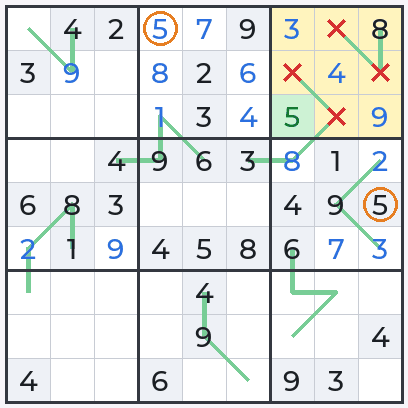

#### Step 18: the 5 in box 1

Box 1 needs a 5. r1c1: row 1 has one (r1c4). r3c1, r3c2 and r3c3: row 3 has one (r3c7). Only **r2c3** is left: **r2c3 = 5**.

#### Step 19: the 1 in box 1

Box 1 needs a 1. r3c1, r3c2 and r3c3: row 3 has one (r3c4). Only **r1c1** is left: **r1c1 = 1**.

#### Step 20: the 2 in box 3

Box 3 needs a 2. r1c8: row 1 has one (r1c3). r2c7 and r2c9: row 2 has one (r2c5). Only **r3c8** is left: **r3c8 = 2**.

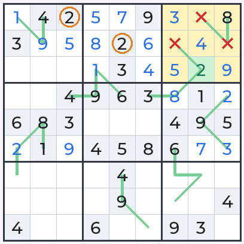

#### Step 21: the 1 in box 3

Box 3 needs a 1. r1c8: row 1 has one (r1c1). r2c7: it's next to the 2 in r3c8 on a green line, and 1 is less than 5 away from it. Only **r2c9** is left: **r2c9 = 1**.

#### Step 22: the 6 in box 3

Box 3 needs a 6. r2c7: row 2 has one (r2c6). Only **r1c8** is left: **r1c8 = 6**.

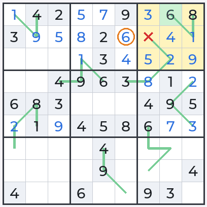

#### Step 23: the 7 in box 3

Box 3 needs a 7, and r2c7 is its last empty cell: **r2c7 = 7**.

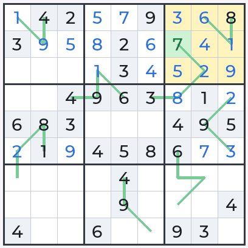

#### Step 24: the 9 in box 7

Box 7 needs a 9. r7c2: column 2 has one (r2c2). r7c3: column 3 has one (r6c3). r8c1, r8c2 and r8c3: row 8 has one (r8c5). r9c2 and r9c3: row 9 has one (r9c7). Only **r7c1** is left: **r7c1 = 9**.

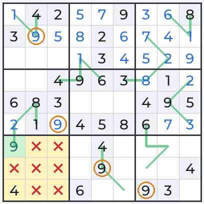

#### Step 25: the 8 in box 8

Box 8 needs an 8. r7c4 and r8c4: column 4 has one (r2c4). r7c6, r8c6 and r9c6: column 6 has one (r6c6). Only **r9c5** is left: **r9c5 = 8**.

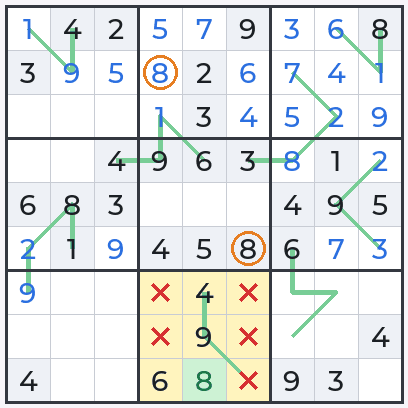

#### Step 26: the 2 in box 9

Box 9 needs a 2. r7c8 and r8c8: column 8 has one (r3c8). r7c9 and r9c9: column 9 has one (r4c9). r7c7: it's next to the 6 in r6c7 on a green line, and 2 is less than 5 away from it. Only **r8c7** is left: **r8c7 = 2**.

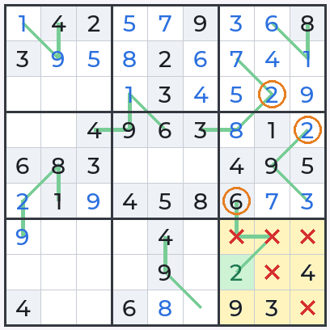

#### Step 27: the 1 in box 9

Box 9 needs a 1. r7c8 and r8c8: column 8 has one (r4c8). r7c9 and r9c9: column 9 has one (r2c9). Only **r7c7** is left: **r7c7 = 1**.

#### Step 28: the 5 in box 9

Box 9 needs a 5. r7c9 and r9c9: column 9 has one (r5c9). r7c8: it's on a green line, and nothing is 5 or more away from a 5. Only **r8c8** is left: **r8c8 = 5**.

#### Step 29: the 5 in box 8

Box 8 needs a 5. r7c4: column 4 has one (r1c4). r8c4 and r8c6: row 8 has one (r8c8). r9c6: it's on a green line, and nothing is 5 or more away from a 5. Only **r7c6** is left: **r7c6 = 5**.

#### Step 30: the 5 in box 7

Box 7 needs a 5. r7c2 and r7c3: row 7 has one (r7c6). r8c1, r8c2 and r8c3: row 8 has one (r8c8). r9c3: column 3 has one (r2c3). Only **r9c2** is left: **r9c2 = 5**.

#### Step 31: the 5 in box 4

Box 4 needs a 5. r4c2: column 2 has one (r9c2). Only **r4c1** is left: **r4c1 = 5**.

#### Step 32: the 7 in box 4

Box 4 needs a 7, and r4c2 is its last empty cell: **r4c2 = 7**.

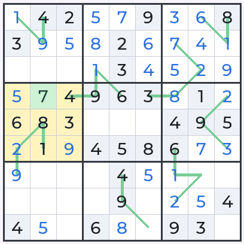

#### Step 33: the 2 in box 7

Box 7 needs a 2. r7c3 and r9c3: column 3 has one (r1c3). r8c1, r8c2 and r8c3: row 8 has one (r8c7). Only **r7c2** is left: **r7c2 = 2**.

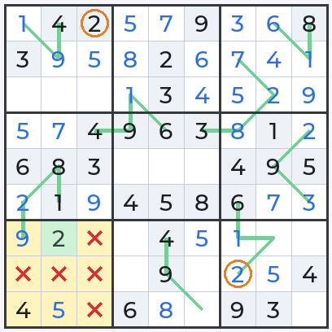

#### Step 34: the 3 in box 7

Box 7 needs a 3. r7c3 and r8c3: column 3 has one (r5c3). r8c1: column 1 has one (r2c1). r9c3: row 9 has one (r9c8). Only **r8c2** is left: **r8c2 = 3**.

#### Step 35: the 2 in box 8

Box 8 needs a 2. r7c4: row 7 has one (r7c2). r8c4 and r8c6: row 8 has one (r8c7). Only **r9c6** is left: **r9c6 = 2**.

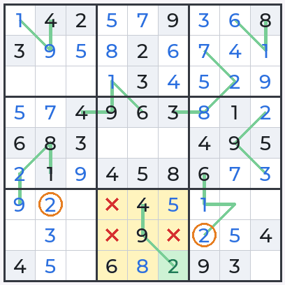

#### Step 36: the 2 in box 5

Box 5 needs a 2. r5c5: column 5 has one (r2c5). r5c6: column 6 has one (r9c6). Only **r5c4** is left: **r5c4 = 2**.

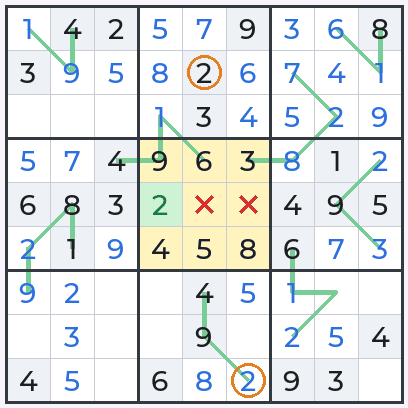

#### Step 37: the 7 in box 5

Box 5 needs a 7. r5c5: column 5 has one (r1c5). Only **r5c6** is left: **r5c6 = 7**.

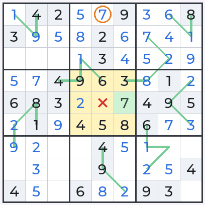

#### Step 38: the 1 in box 5

Box 5 needs a 1, and r5c5 is its last empty cell: **r5c5 = 1**.

#### Step 39: the 1 in box 8

Box 8 needs a 1. r7c4: row 7 has one (r7c7). r8c4: column 4 has one (r3c4). Only **r8c6** is left: **r8c6 = 1**.

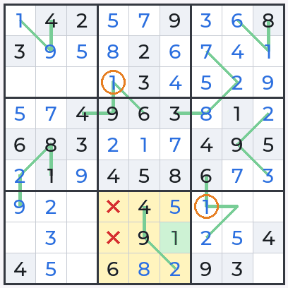

#### Step 40: the 1 in box 7

Box 7 needs a 1. r7c3: row 7 has one (r7c7). r8c1 and r8c3: row 8 has one (r8c6). Only **r9c3** is left: **r9c3 = 1**.

#### Step 41: the 3 in box 8

Box 8 needs a 3. r8c4: row 8 has one (r8c2). Only **r7c4** is left: **r7c4 = 3**.

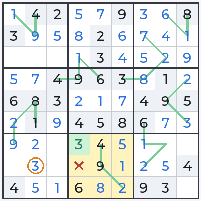

#### Step 42: the 7 in box 8

Box 8 needs a 7, and r8c4 is its last empty cell: **r8c4 = 7**.

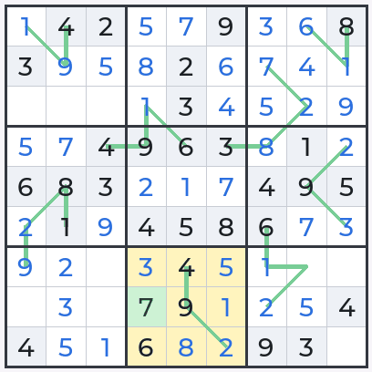

#### Step 43: the 7 in box 7

Box 7 needs a 7. r8c1 and r8c3: row 8 has one (r8c4). Only **r7c3** is left: **r7c3 = 7**.

#### Step 44: the 7 in box 1

Box 1 needs a 7. r3c2: column 2 has one (r4c2). r3c3: column 3 has one (r7c3). Only **r3c1** is left: **r3c1 = 7**.

#### Step 45: the 8 in box 1

Box 1 needs an 8. r3c2: column 2 has one (r5c2). Only **r3c3** is left: **r3c3 = 8**.

#### Step 46: the 6 in box 1

Box 1 needs a 6, and r3c2 is its last empty cell: **r3c2 = 6**.

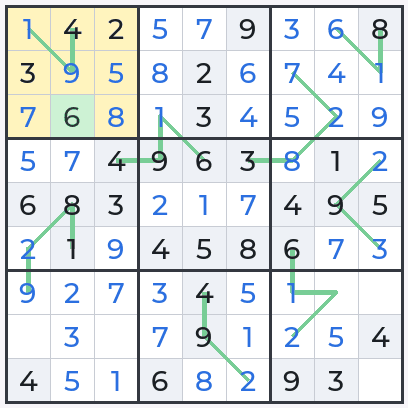

#### Step 47: the 6 in box 7

Box 7 needs a 6. r8c1: column 1 has one (r5c1). Only **r8c3** is left: **r8c3 = 6**.

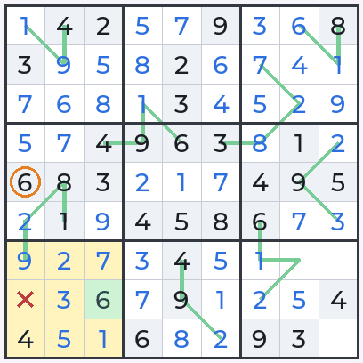

#### Step 48: the 8 in box 7

Box 7 needs an 8, and r8c1 is its last empty cell: **r8c1 = 8**.

#### Step 49: the 6 in box 9

Box 9 needs a 6. r7c8: column 8 has one (r1c8). r9c9: row 9 has one (r9c4). Only **r7c9** is left: **r7c9 = 6**.

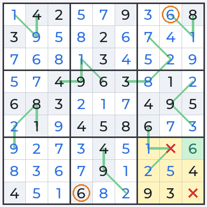

#### Step 50: the 7 in box 9

Box 9 needs a 7. r7c8: row 7 has one (r7c3). Only **r9c9** is left: **r9c9 = 7**.

#### Step 51: the 8 in box 9

Box 9 needs an 8, and r7c8 is its last empty cell: **r7c8 = 8**.

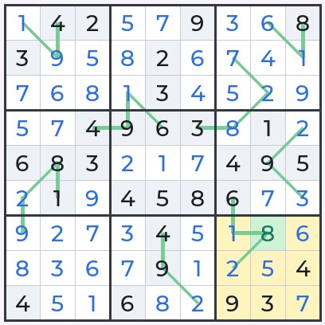

Solved.

<!-- /walkthrough -->
