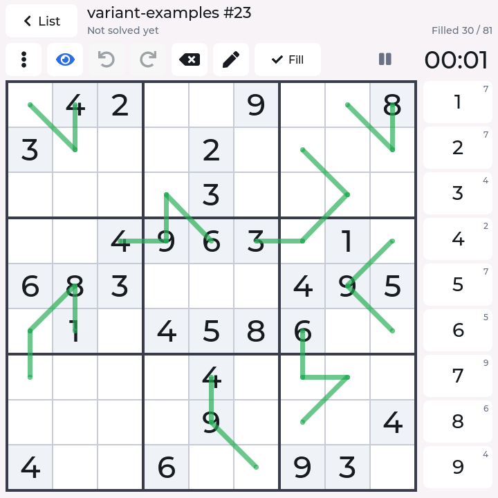
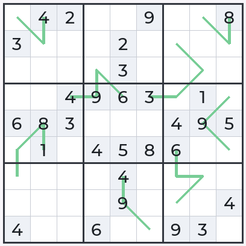

# German Whispers

[← All variants](README.md) · [Puzzles](../features-puzzles.md) · [How to play](../how-to-play.md)

## The rules

[Classic](classic.md) rules, plus **green lines** through cells side by side or diagonal. Along a line, **two neighbours differ by at least 5**: 2 next to 8 is fine, 3 next to 7 isn't. So a line alternates low and high digits, and there's **never a 5 on a line** (nothing is 5 away from it).

## On the board

- Each line is a narrow green line under the digits.
- Two neighbours on a line less than 5 apart turn red.
- The grader and hints narrow each line cell by its neighbours: "Along this line, neighbours are 5 or more apart, so row 4, column 9 can only be 1, 2, 3, 4".
- **Puzzles → ⋮ → New puzzle → Whispers** (German Whispers): 8 lines (Hard and Expert 10) of 3 to 6 cells.

## How to solve it

- **No 5 on a line.** Ever: rule it out of every green cell first.
- **Low and high alternate:** the digits 1–4 are "low", 6–9 "high"; along a line they take turns. Once one cell's side is known, the whole line's is.
- **4 and 6 are fussy:** the only digit 5 or more away from a 4 is 9, and from a 6 it's 1. A 4 in the middle of a line needs a 9 on each side, so those two cells mustn't share a row, column or box.
- **Next to an extreme, little is left:** next to a 9, a cell is 1 to 4; next to an 8, 1 to 3.

## Worked example

**variant-examples #23**, German Whispers Easy (see [Classic](classic.md#worked-example-the-whole-puzzle) for how to import the examples; cells are written r*row*c*column*). The lines are in the screenshot; three matter here:

- r6c9, r5c8 (a 9), r4c9;
- r6c2 (a 1), r5c2 (an 8), r6c1, r7c1;
- r1c8, r2c9, r1c9 (an 8).

**Step 1: r4c9, next to a 9.** Row 4 has 9, 6, 3, 4 and 1; column 9 has 8 and 5; that leaves 2 and 7. On its line, r4c9 is next to the 9 in r5c8, and 7 is only 2 away from 9. **r4c9 = 2**.

**Step 2: the 9 in row 6.** Row 6 needs a 9; its empty cells are r6c1, r6c3, r6c8 and r6c9.

- r6c8, r6c9: column 8 and box 6 have a 9 (r5c8).
- r6c1: on its line it's next to the 8 in r5c2, so it's at most 3.

Only **r6c3** is left: **r6c3 = 9**.

**Step 3: the 9 in row 2.** Row 2 needs a 9; columns 3, 4, 6, 7 and 8 already have one, which rules out r2c3, r2c4, r2c6, r2c7 and r2c8. And r2c9 is on a line next to the 8 in r1c9, so it's at most 3. Only **r2c2** is left: **r2c2 = 9**.

## The whole puzzle, step by step

<!-- walkthrough -->
<!-- Written by tools/walkthrough.py german-whispers: edit the script, not this part. -->

The whole puzzle, from the start to the last cell: 51 steps, each one a single (one place left for a digit, or one digit left for a cell), taken in the order a box's single comes first, so not quite the order of the worked example above. Each step has a page of its own, with **Previous** and **Next**: pick its number below. In each picture, the unit the step looks at is tinted yellow (for a cell with one digit left: its row, column and box), the new digit is on green, the digits that rule cells out have an **orange ring**, and the empty cells they rule out a **red cross**. Givens are on grey, digits from earlier steps in blue.

| [1](german-whispers/step-01.md) | [2](german-whispers/step-02.md) | [3](german-whispers/step-03.md) | [4](german-whispers/step-04.md) | [5](german-whispers/step-05.md) | [6](german-whispers/step-06.md) | [7](german-whispers/step-07.md) | [8](german-whispers/step-08.md) | [9](german-whispers/step-09.md) | [10](german-whispers/step-10.md) |
|:-:|:-:|:-:|:-:|:-:|:-:|:-:|:-:|:-:|:-:|
| [11](german-whispers/step-11.md) | [12](german-whispers/step-12.md) | [13](german-whispers/step-13.md) | [14](german-whispers/step-14.md) | [15](german-whispers/step-15.md) | [16](german-whispers/step-16.md) | [17](german-whispers/step-17.md) | [18](german-whispers/step-18.md) | [19](german-whispers/step-19.md) | [20](german-whispers/step-20.md) |
| [21](german-whispers/step-21.md) | [22](german-whispers/step-22.md) | [23](german-whispers/step-23.md) | [24](german-whispers/step-24.md) | [25](german-whispers/step-25.md) | [26](german-whispers/step-26.md) | [27](german-whispers/step-27.md) | [28](german-whispers/step-28.md) | [29](german-whispers/step-29.md) | [30](german-whispers/step-30.md) |
| [31](german-whispers/step-31.md) | [32](german-whispers/step-32.md) | [33](german-whispers/step-33.md) | [34](german-whispers/step-34.md) | [35](german-whispers/step-35.md) | [36](german-whispers/step-36.md) | [37](german-whispers/step-37.md) | [38](german-whispers/step-38.md) | [39](german-whispers/step-39.md) | [40](german-whispers/step-40.md) |
| [41](german-whispers/step-41.md) | [42](german-whispers/step-42.md) | [43](german-whispers/step-43.md) | [44](german-whispers/step-44.md) | [45](german-whispers/step-45.md) | [46](german-whispers/step-46.md) | [47](german-whispers/step-47.md) | [48](german-whispers/step-48.md) | [49](german-whispers/step-49.md) | [50](german-whispers/step-50.md) |
| [51](german-whispers/step-51.md) |  |  |  |  |  |  |  |  |  |

Solved.

<!-- /walkthrough -->
