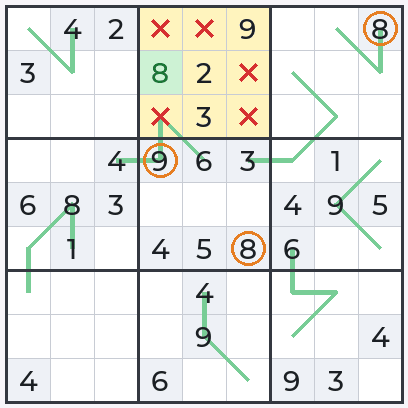

<!-- Written by tools/walkthrough.py german-whispers: edit the script, not this page. -->
# German Whispers, step 1: the 8 in box 2

**Step 1 of 51** · [← The start](../german-whispers.md#the-whole-puzzle-step-by-step) · [All steps](../german-whispers.md#the-whole-puzzle-step-by-step) · [Step 2 →](step-02.md)

Box 2 needs an 8. r1c4 and r1c5: row 1 has one (r1c9). r2c6 and r3c6: column 6 has one (r6c6). r3c4: it's next to the 9 in r4c4 on a green line, and 8 is less than 5 away from it. Only **r2c4** is left: **r2c4 = 8**.

**Step 1 of 51** · [← The start](../german-whispers.md#the-whole-puzzle-step-by-step) · [All steps](../german-whispers.md#the-whole-puzzle-step-by-step) · [Step 2 →](step-02.md)
