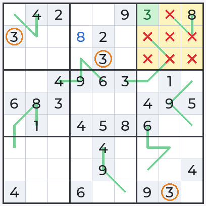

<!-- Written by tools/walkthrough.py german-whispers: edit the script, not this page. -->
# German Whispers, step 2: the 3 in box 3

**Step 2 of 51** · [← Step 1](step-01.md) · [All steps](../german-whispers.md#the-whole-puzzle-step-by-step) · [Step 3 →](step-03.md)

Box 3 needs a 3. r1c8: column 8 has one (r9c8). r2c7, r2c8 and r2c9: row 2 has one (r2c1). r3c7, r3c8 and r3c9: row 3 has one (r3c5). Only **r1c7** is left: **r1c7 = 3**.

**Step 2 of 51** · [← Step 1](step-01.md) · [All steps](../german-whispers.md#the-whole-puzzle-step-by-step) · [Step 3 →](step-03.md)
