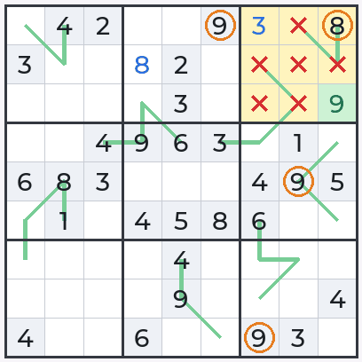

<!-- Written by tools/walkthrough.py german-whispers: edit the script, not this page. -->
# German Whispers, step 3: the 9 in box 3

**Step 3 of 51** · [← Step 2](step-02.md) · [All steps](../german-whispers.md#the-whole-puzzle-step-by-step) · [Step 4 →](step-04.md)

Box 3 needs a 9. r1c8: row 1 has one (r1c6). r2c7 and r3c7: column 7 has one (r9c7). r2c8 and r3c8: column 8 has one (r5c8). r2c9: it's next to the 8 in r1c9 on a green line, and 9 is less than 5 away from it. Only **r3c9** is left: **r3c9 = 9**.

**Step 3 of 51** · [← Step 2](step-02.md) · [All steps](../german-whispers.md#the-whole-puzzle-step-by-step) · [Step 4 →](step-04.md)
