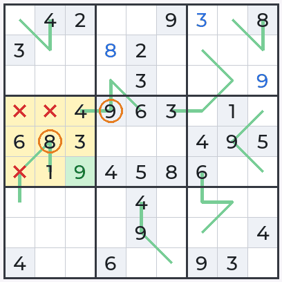

<!-- Written by tools/walkthrough.py german-whispers: edit the script, not this page. -->
# German Whispers, step 4: the 9 in box 4

**Step 4 of 51** · [← Step 3](step-03.md) · [All steps](../german-whispers.md#the-whole-puzzle-step-by-step) · [Step 5 →](step-05.md)

Box 4 needs a 9. r4c1 and r4c2: row 4 has one (r4c4). r6c1: it's next to the 8 in r5c2 on a green line, and 9 is less than 5 away from it. Only **r6c3** is left: **r6c3 = 9**.

**Step 4 of 51** · [← Step 3](step-03.md) · [All steps](../german-whispers.md#the-whole-puzzle-step-by-step) · [Step 5 →](step-05.md)
