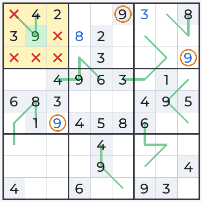

<!-- Written by tools/walkthrough.py german-whispers: edit the script, not this page. -->
# German Whispers, step 5: the 9 in box 1

**Step 5 of 51** · [← Step 4](step-04.md) · [All steps](../german-whispers.md#the-whole-puzzle-step-by-step) · [Step 6 →](step-06.md)

Box 1 needs a 9. r1c1: row 1 has one (r1c6). r2c3: column 3 has one (r6c3). r3c1, r3c2 and r3c3: row 3 has one (r3c9). Only **r2c2** is left: **r2c2 = 9**.

**Step 5 of 51** · [← Step 4](step-04.md) · [All steps](../german-whispers.md#the-whole-puzzle-step-by-step) · [Step 6 →](step-06.md)
