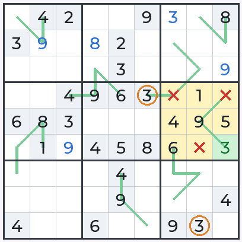

<!-- Written by tools/walkthrough.py german-whispers: edit the script, not this page. -->
# German Whispers, step 6: the 3 in box 6

**Step 6 of 51** · [← Step 5](step-05.md) · [All steps](../german-whispers.md#the-whole-puzzle-step-by-step) · [Step 7 →](step-07.md)

Box 6 needs a 3. r4c7 and r4c9: row 4 has one (r4c6). r6c8: column 8 has one (r9c8). Only **r6c9** is left: **r6c9 = 3**.

**Step 6 of 51** · [← Step 5](step-05.md) · [All steps](../german-whispers.md#the-whole-puzzle-step-by-step) · [Step 7 →](step-07.md)
